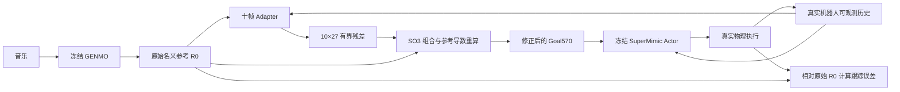

# GENMO Stage2：SuperMimic 十帧参考 Adapter

本分支在冻结 GENMO 生成的舞蹈参考上学习小幅补偿，让冻结 SuperMimic Actor 的真实执行更接近**原始 GENMO 动作**。训练采用真实物理采集、独立世界模型（WM）监督和闭环 BPTT；部署只运行 GENMO、Adapter 和 SuperMimic Actor。

| 项目 | 当前入口或约定 |
|---|---|
| GENMO 分支 | `feature/stage2-supermimic-adapter` |
| 配套 SuperMimic 分支 | `feature/genmo-worldmodel-bridge`，仓库 `XiaoxiaoKuankuan/-supermimic` |
| 本机工作树 | `/home/weili/bumi-closedloop-worktrees/adapter/GENMO` |
| Server-1 开发树 | `/home/user/liwei/bumi-closedloop-worktrees/adapter/GENMO` |
| 训练启动 | [tools/launch_stage2_alternating.py](tools/launch_stage2_alternating.py) |
| 单GPU训练循环 | [tools/train_stage2_alternating.py](tools/train_stage2_alternating.py) |
| 音乐 → MuJoCo sim2sim | [scripts/demo/run_genmo_sm_adapter_sim2sim.py](scripts/demo/run_genmo_sm_adapter_sim2sim.py) |
| Adapter ONNX 导出 | [tools/export/export_reference_adapter_onnx.py](tools/export/export_reference_adapter_onnx.py) |

当前主线是 **Stage2-A：冻结 GENMO 生成缓存上的训练**。在线滚动接口保留在 `rolling.py`，尚不能将固定缓存的训练/评价结果当成 Stage2-B 连续滚动验证。旧 GMT、PPO/DPPO、Oracle 和硬投影研究入口保留历史用途，不是下面命令使用的正式方法。

## 1. 方法与模型合同



### 十帧 Adapter

- 网络固定为 `2654 → 512 → 512 → 256 → 270`，三个 SiLU 隐藏层，最后一层零初始化。
- 每次控制输出 `[B,10,27]`，对应未来 `t+1 … t+10`；每帧是根平移3维、根旋转向量3维、RobotSpec顺序的21个关节修正。
- 当前配置关闭根XY残差，保留根高度、根姿态和关节修正。网络仍输出270维，关闭的通道置零。
- `Tanh` 保证小幅有界输出：根高度上限0.02m，根旋转向量范数上限0.05rad，普通关节0.10rad、踝关节0.05rad。
- 姿态按 `R_corrected = R_nominal @ Exp(delta_rotation)` 组合；关节按 `q_corrected = q_nominal + delta_q` 修正。平移残差在episode初始名义heading坐标系中转换到世界系。
- 当前帧继承已提交锚点。残差相对原始参考定义，不累计到上一轮残差；名义GENMO缓存保持只读。
- 统一重算参考导数并构造 `Goal570 = 10 × 57`。第11点只提供导数halo，使用真实名义第11点和 `d11 = 2*d10-d9`，不会产生第11个Goal。

当前执行方式是 `bounded_direct_no_derivative_constraints`：**没有QP/SQP/IPM硬导数投影，也没有固定低通滤波**。参考连续性通过可微软成本学习，SO(3)组合和幅值限幅仍保留。

2654维输入由 [InputSpec](gem/closedloop/reference_adapter/contracts.py) 定义：10×75控制历史、原Goal570、可观测关节/姿态误差、上一计划与锚点、时间和有效mask、当前及未来15个30Hz EDGE35音乐特征、因果音乐统计。Adapter和冻结Actor没有新增世界XY位置真值输入；绝对根位置误差只用于训练目标，不能据此宣称已具备可部署的累计XY位置反馈。

### WM＋BPTT 交替训练

1. 当前Adapter修正参考，冻结Actor生成动作，在真实Newton物理中采集连续转移。Replay记录实际执行动作、状态、`xi`和下一状态，不跨episode拼接窗口。
2. 使用最新真实Replay训练独立WM：监督窗口固定H8，第一步从真实状态开始，后续递归输入WM预测状态，8步全部使用真实标签监督。独立WM从原SuperMimic预训练权重初始化；其归一化沿用已有统计并使用真实采集更新，Actor及Actor normalizer保持冻结。
3. 从真实起点展开H步想象。**每一步**重新计算Adapter、参考、Actor动作和WM下一状态，不是一次预测H步终态。只detach起点，内部状态、历史和计划保留有效梯度。
4. 冻结Actor与WM参数，通过累计折扣奖励BPTT更新Adapter。下一轮重新真实采集并训练WM。当前主线关闭Critic及其终端价值。

`reference_steps=10` 与 `bptt_steps=H` 是两个独立参数。控制50Hz、物理200Hz；音乐30Hz，统一600Hz tick对齐。WM仅参与训练，sim2sim控制不调用WM。

### 当前奖励与终止

保留SuperMimic六项指数Tracking公式和原身体集合/对齐方式；使用当前配置的尺度与权重，零Adapter和候选以同一标准评价：

| Tracking项 | 求和权重 | 误差尺度 |
|---|---:|---|
| 根位置 | 1.2 | 0.2m |
| 根姿态 | 1.0 | 0.3rad |
| 身体关键点位置 | 1.0 | 0.1m |
| 身体关键点姿态 | 1.0 | 0.15rad |
| 身体线速度 | 1.0 | 沿用SM原尺度 |
| 身体角速度 | 1.0 | 沿用SM原尺度 |

原SM action-rate成本保留，软关节限位成本关闭。额外目标包括身体姿态、关节q/qd和局部根位移精度，以及名义heading系的绝对根XY Huber损失：

```text
e_xy = (yaw(R_nominal).T @ (p_executed - p_nominal))[:2]
C_root_xy = mean(Huber(e_xy / 0.2))
r_root_aux = -0.02 * lambda_root * C_root_xy
```

六项参考连续性软成本为：相对名义参考新增的关节速度、关节加速度、根角速度、根角加速度，以及同绝对时刻的关节/根姿态计划重叠差。导数复用实际Actor Goal定义，覆盖历史接缝和halo；不惩罚GENMO本身的正常快速动作，也不强制投影参考。权重与固定尺度由训练集标定。

音乐奖励权重为 `1e-4`，活动度成本权重为 `0.05`；不增加额外body angular velocity Huber或接触损失。SM奖励已有dt，新增成本各只乘一次 `dt=0.02`。所有跟踪目标和终止判据都指向原始GENMO参考。

真实根高度偏差大于0.2m，或重力投影z分量差 `abs(R[2,2]-R_nominal[2,2]) > 0.6`，记为失败并重置对应环境。评价退化只记录及参与best选择，不触发训练早停或逐更新回滚；NaN/Inf、OOM和物理求解异常仍保存现场并停止对应进程。

## 2. 环境、资产与配置

本机演示/导出使用 `/home/weili/GENMO/.venv/bin/python`。Server-1训练使用：

```text
Python:    /data0/user/liwei/envs/genmo_adapter_runtime_20261026/bin/python
Isaac Lab: /data0/user/liwei/GENMO_assets/adapter_20261026/IsaacLab
输出根:    /data0/user/liwei/GENMO_outputs/stage2_supermimic_adapter/
```

训练物理后端是现有Isaac Lab 3 / Newton / MuJoCo-Warp运行环境；本机交互演示使用原生MuJoCo。它们不是同一个物理求解器。

| 配置 | 用途 |
|---|---|
| [stage2_absolute_root_20261029/gpu0.yaml](configs/closedloop/stage2_absolute_root_20261029/gpu0.yaml) 至 `gpu7.yaml` | Server-1当前八组训练源配置 |
| [adapter_sim2sim_mujoco.yaml](configs/closedloop/adapter_sim2sim_mujoco.yaml) | 本机GENMO、SM、Adapter、音乐基线、缓存与输出路径 |

模型和名义缓存不随Git自动下载。换机器时修改配置中的 `genmo.checkpoint/stats/kinematics`、`supermimic.repo/checkpoint/robot_asset_dir`、`music_baseline`、`tasks`及训练标定文件路径。当前训练任务清单为服务器上的 `stage2a_projection_20261027_01/tasks_64_generated.json`，名字中的projection是历史资产目录名，不表示当前启用硬投影。名义动作必须来自冻结GENMO实际生成，不能用数据集原始动作替代。

默认本机资产为Stage1 `s595000.pt`、BUMI SuperMimic `ckpt_024000.pt`和已保全的GPU7/u2600 Adapter。模型具体路径以本机配置为准；BUMI是21关节，不使用G1的29关节部署模型。

## 3. 训练脚本：Server-1

推荐使用启动器；它为本次运行建立GENMO和SM源码快照，逐卡创建tmux与独立输出目录，防止开发树后续修改影响训练。先确认GPU空闲；默认跳过已有计算任务，不终止其他进程。以下命令会实际启动训练。

### 单GPU、多环境

```bash
cd /home/user/liwei/bumi-closedloop-worktrees/adapter/GENMO
ADAPTER_RUN_TAG="$(date +%Y%m%d_%H%M%S)"

/data0/user/liwei/envs/genmo_adapter_runtime_20261026/bin/python -B \
  tools/launch_stage2_alternating.py \
  --config-dir configs/closedloop/stage2_absolute_root_20261029 \
  --gpus 0 \
  --root "/data0/user/liwei/GENMO_outputs/stage2_supermimic_adapter/adapter_single_${ADAPTER_RUN_TAG}" \
  --session-prefix "adapter_single_${ADAPTER_RUN_TAG}"
```

该命令使用 `gpu0.yaml`，单进程管理2048个物理环境。改为 `--gpus 7` 会使用 `gpu7.yaml`，不会把gpu0配置自动映射到GPU7。

### 八GPU、八个独立实验

```bash
cd /home/user/liwei/bumi-closedloop-worktrees/adapter/GENMO
ADAPTER_RUN_TAG="$(date +%Y%m%d_%H%M%S)"

/data0/user/liwei/envs/genmo_adapter_runtime_20261026/bin/python -B \
  tools/launch_stage2_alternating.py \
  --config-dir configs/closedloop/stage2_absolute_root_20261029 \
  --gpus 0,1,2,3,4,5,6,7 \
  --root "/data0/user/liwei/GENMO_outputs/stage2_supermimic_adapter/adapter8_${ADAPTER_RUN_TAG}" \
  --session-prefix "adapter8_${ADAPTER_RUN_TAG}"
```

每进程仅可见一张GPU；没有DDP、torchrun或NCCL通信。各组Adapter、WM、Replay、优化器、RNG和checkpoint独立。需要排队时显式加 `--wait-for-free-gpus`；排队状态不算训练已启动。

| GPU | BPTT | 根XY辅助权重λ | 参考连续性 | Critic | Seed |
|---|---:|---:|---|---|---:|
| 0 | H32 | 0.8300100327 | 弱 | 关闭 | 42 |
| 1 | H32 | 0.8300100327 | 强 | 关闭 | 42 |
| 2 | H32 | 1.4910286903 | 弱 | 关闭 | 42 |
| 3 | H32 | 1.4910286903 | 强 | 关闭 | 42 |
| 4 | H64 | 0.8300100327 | 弱 | 关闭 | 42 |
| 5 | H64 | 0.8300100327 | 强 | 关闭 | 42 |
| 6 | H64 | 1.4910286903 | 弱 | 关闭 | 42 |
| 7 | H64 | 1.4910286903 | 强 | 关闭 | 42 |

强档将六项连续性权重统一乘3，物理尺度不变。共同参数：2048环境、Adapter batch1024/microbatch256/LR `1e-5`、WM H8/batch2048/LR `3e-5`、每轮10次WM更新、gamma0.99、100轮WM-only预热、动作与观测噪声关闭、目标10000次Adapter Adam更新。每轮按UTD0.4交替采集2/3个向量控制步。

源配置目录必须显式指定；启动器自身的历史默认目录不是上述实验矩阵。`target_accepted_updates=10000`表示累计优化器更新目标，不是episode数，也不是10000次WM监督。

### 恢复、日志和评价

同组恢复时，在上述启动命令上增加 `--resume-root /完整路径/旧八组运行根目录`，并使用新的 `--root` 和 `--session-prefix`。启动器分别读取各组 `gpuN/latest_checkpoint.json`，不会在不同实验之间共享在线Replay。单进程底层入口也支持：

```bash
CUDA_VISIBLE_DEVICES=0 OMP_NUM_THREADS=1 MKL_NUM_THREADS=1 \
ISAACLAB_PATH=/data0/user/liwei/GENMO_assets/adapter_20261026/IsaacLab \
/data0/user/liwei/envs/genmo_adapter_runtime_20261026/bin/python -B -u \
  tools/train_stage2_alternating.py \
  --config /完整路径/旧运行的config_gpu0.yaml \
  --resume /完整路径/该组full_checkpoint.pt \
  --output /完整路径/新的恢复目录 \
  --visualizer none --deterministic
```

完整恢复需要 `full_*.pt`；仅含推理权重的快照和ONNX不能恢复优化器/Replay。恢复保留学习状态，物理从新episode开始，不伪造求解器隐藏状态的连续恢复。直接运行底层入口时，应使用独立且不在训练期间修改的源码目录。

- 运行根的 `launch_manifest.json`：实际命令、GPU、tmux、配置、跳过原因；`gpuN.log`：控制台日志。
- 每组 `status.json`、`pid`、`training.jsonl`：真实转移、WM更新、Adapter更新、阶段及耗时。
- `objective_gradients.jsonl`：根辅助/精度/连续性分项梯度及方向。
- `latest_checkpoint.json`、`best_checkpoint.json`：完整恢复文件指针；best由validation选择，零Adapter也参与候选。
- 更新0/10做短时物理对照，20/50/100/200/500及每1000次做整歌validation/evaluation；每200次及评价节点保存完整checkpoint。保留零模型、best、最近两份完整状态和编号轻量权重。

评价与零Adapter采用同歌曲、同初态、同物理参数、无探索噪声，报告六项Tracking、q/qd、身体姿态、根RMSE、jerk、真实接触脚滑和完整率。`evaluation`是独立报告划分，不能用于反复选参数；想象奖励和训练平均回报不能替代真实物理结果。

已有模型的独立评价入口是 [tools/evaluate_stage2_alternating_checkpoints.py](tools/evaluate_stage2_alternating_checkpoints.py)，通过 `--splits train` 可评价训练集，通过 `--splits validation evaluation` 评价独立划分；不执行优化器更新。64首多模型比较使用 [evaluate_adapter_train_matrix.py](tools/eval/evaluate_adapter_train_matrix.py)。

## 4. sim2sim脚本：输入音乐，在MuJoCo看参考与机器人

在本机执行，把 `--audio` 换成自己的音乐路径：

```bash
cd /home/weili/bumi-closedloop-worktrees/adapter/GENMO

/home/weili/GENMO/.venv/bin/python -B \
  scripts/demo/run_genmo_sm_adapter_sim2sim.py \
  --audio "/完整路径/音乐.wav"
```

支持WAV/MP3/FLAC。首次处理音乐时先提取EDGE35并用冻结GENMO生成完整固定参考，随后打开窗口；相同资产与参数可复用缓存。默认CUDA:0，可加 `--device cpu` 或指定其他本机GPU。

- **蓝色半透明机器人**：原始GENMO名义参考，未按实际根位置重新对齐。
- **实体机器人**：冻结SM Actor＋Adapter在MuJoCo中的真实动力学执行，50Hz控制、200Hz物理。
- **B**：已训练Adapter/零Adapter切换，并从相同参考与初态重播；**R**：重播；**空格**：暂停；**G**：影子开关；**Esc**：退出。

更换Adapter或从零基线开始，分别添加：

```bash
--adapter-checkpoint "/完整路径/adapter_checkpoint.pt"
--zero-adapter
```

无窗口、无音频、有界运行示例：

```bash
/home/weili/GENMO/.venv/bin/python -B \
  scripts/demo/run_genmo_sm_adapter_sim2sim.py \
  --audio "/完整路径/音乐.wav" \
  --headless --mute --fast --max-seconds 10
```

配置见 [adapter_sim2sim_mujoco.yaml](configs/closedloop/adapter_sim2sim_mujoco.yaml)。默认使用已保全GPU7/u2600快照；输出写入全新 `../sim2sim_runs/时间戳_唯一标识/`。`launch.json`是配置记录，`summary.json`是本次物理结果，`episode_*.npz`保存真实状态、动作、参考及Goal。此入口目前使用PyTorch推理，不自动加载下面的ONNX。

任意音乐演示的GENMO历史来自已生成的名义动作，不读取未来实际执行；它属于Stage2-A固定参考演示，不是训练缓存的Newton评价复现或Stage2-B在线闭环。详细操作与已测性能见 [MuJoCo说明](docs/closedloop/adapter_sim2sim_mujoco.rst)。

## 5. 导出ONNX脚本

默认导出本机配置绑定的GPU7/u2600模型，使用CPU，不占训练GPU：

```bash
cd /home/weili/bumi-closedloop-worktrees/adapter/GENMO

/home/weili/GENMO/.venv/bin/python -B \
  tools/export/export_reference_adapter_onnx.py \
  --output "../exports/adapter_$(date +%Y%m%d_%H%M%S)"
```

更换模型加 `--checkpoint /完整路径/模型.pt`；更换资产配置加 `--config /完整路径/配置.yaml`。输出目录必须是新目录，脚本不覆盖已有文件。

| 文件/接口 | 内容 |
|---|---|
| `adapter.onnx` | MLP、Tanh限幅、旋转向量范数限幅、根通道开关 |
| `metadata.json` | 输入字段及扁平偏移、归一化要求、关节顺序、幅值、来源checkpoint SHA |
| `parity_report.json` | ONNXRuntime CPU与原PyTorch的数值对比 |
| 输入 `adapter_input` | `float32 [B,2654]`，已按InputSpec拼接和归一化 |
| 输出 `residual_plan` | `float32 [B,10,27]`，相对名义参考的未来十帧残差 |

脚本执行ONNX结构检查，并核对batch1/16的零、随机和大幅输入。现成导出位于：

```text
/home/weili/bumi-closedloop-worktrees/adapter/exports/adapter_g7_u2600/
```

该真实模型约7MB，六组数值核验最大绝对误差 `6.33e-8`。输入特征拼接/归一化、音乐历史、SO(3)参考组合、锚点、halo、Goal570和Actor不在Adapter图内，仍由控制程序执行。

部署需要匹配的GENMO、Adapter和SuperMimic Actor及其统计/机器人配置；WM、Critic、Replay和优化器不参与部署。已有GENMO/SM部署模型可复用；GENMO单步去噪ONNX之外仍需要采样循环，SM策略图已有normalizer时不能重复归一化。Adapter导出成功不等于整条ONNX运行链或真机已验证。

## 6. 已有结果与代码导航

2026-10-30固定16份候选，在同64首**训练歌曲**上配对筛选，GPU7/u2600再与零Adapter各重复两遍：

| 指标 | 零Adapter | GPU7/u2600 |
|---|---:|---:|
| 完整预算Tracking | 0.097236 | 0.105255（+8.25%） |
| 世界根位置RMSE | 0.333750m | 0.138147m（−58.61%） |
| 关节q RMSE | 0.100645rad | 0.084664rad（−15.88%） |
| 关节qd RMSE | 0.715618rad/s | 0.677525rad/s（−5.32%） |
| 身体姿态RMSE | 0.129278rad | 0.110478rad（−14.54%） |
| 完整次数 | 128/128 | 128/128 |

同时jerk增加3.09%、脚滑增加1.93%、Beat F1下降1.86%。这是训练集内选型结果，不是独立测试泛化或当前所有新checkpoint的排名。本机新生成BoomBoomPow的MuJoCo完整对照还出现关节改善但根RMSE变差，不能把Newton收益直接外推到sim2sim。

- [绝对根位置与参考连续性方法、标定和八组配置](docs/closedloop/stage2_absolute_root_continuity_20261029.md)
- [64首训练集完整报告、负例与视频](docs/closedloop/adapter_train64_rootcont_20261030.rst)
- [MuJoCo运行、性能与导出说明](docs/closedloop/adapter_sim2sim_mujoco.rst)
- [Adapter核心模块](gem/closedloop/reference_adapter)：`contracts.py`、`policy.py`、`vector_control.py`、`precision.py`、`alternating_learning.py`、`alternating_entry.py`。
- [回归测试](tests/closedloop/reference_adapter)与[修改记录](记录文本.md)。历史文档按日期保留，旧硬投影/审计门槛描述不覆盖本README对应的当前正式配置。

仅查看脚本参数，不启动训练或物理：

```bash
/home/weili/GENMO/.venv/bin/python -B tools/train_stage2_alternating.py --help
/home/weili/GENMO/.venv/bin/python -B tools/launch_stage2_alternating.py --help
/home/weili/GENMO/.venv/bin/python -B scripts/demo/run_genmo_sm_adapter_sim2sim.py --help
/home/weili/GENMO/.venv/bin/python -B tools/export/export_reference_adapter_onnx.py --help
```

## 上游项目、引用与许可

本分支基于 NVIDIA GEM / GENMO，保留其上游代码与归属说明。
[上游项目页](https://research.nvidia.com/labs/dair/gem/)。

```bibtex
@inproceedings{genmo2025,
  title     = {GENMO: A GENeralist Model for Human MOtion},
  author    = {Li, Jiefeng and Cao, Jinkun and Zhang, Haotian and Rempe, Davis and Kautz, Jan and Iqbal, Umar and Yuan, Ye},
  booktitle = {Proceedings of the IEEE/CVF International Conference on Computer Vision (ICCV)},
  year      = {2025}
}
```

本项目采用 NVIDIA OneWay Noncommercial License，见 [LICENSE](LICENSE)。第三方组件遵循各自许可证，见 [ATTRIBUTIONS.md](ATTRIBUTIONS.md)及配套SuperMimic仓库。
