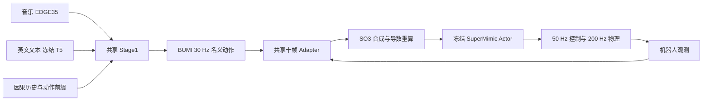

# BUMI 音乐／英文文本共享 Stage1 与 Adapter 两阶段训练

本分支 `feature/bumi-music-text-adapter` 从 `33d02cb` 建立：用同一个生成主干从头混合学习音乐和英文文本，再用同一个十帧 Adapter 修正两类名义动作的执行。每次生成选择 **音乐或文本其中一种**；没有训练音乐＋文本同时控制、视频或摄像头输入。



完整的资产准备、训练／恢复、生成、离线评价和 sim2sim 命令见 **[两阶段使用说明](docs/MULTIMODAL_TRAINING.md)**。新工作树为 `/home/weili/bumi-closedloop-worktrees/multimodal/GENMO`；原 Adapter 工作树及其未提交 ONNX 修改未移入本分支。

| 功能 | 入口 |
|---|---|
| 联合数据去重、划分审计和 train-only 统计 | [prepare_multimodal_stage1.py](tools/data/bumi/prepare_multimodal_stage1.py) |
| Stage1 训练、完整恢复、固定验证 | [train_closedloop_stage1.py](tools/train_closedloop_stage1.py) + [stage1.yaml](configs/multimodal/stage1.yaml) |
| 音乐／文本生成完整名义轨迹 | [generate_bumi_multimodal.py](tools/generate_bumi_multimodal.py) |
| Stage1 配对质量报告与文本盲评包 | [evaluate_bumi_multimodal_generation.py](tools/evaluate_bumi_multimodal_generation.py) |
| Stage2 任务／初态准备 | [prepare_stage2_multimodal_assets.py](tools/prepare_stage2_multimodal_assets.py) |
| 新 Stage1 实际生成缓存 | [prepare_stage2_multimodal_reference.py](tools/prepare_stage2_multimodal_reference.py) |
| 新联合 train 零策略真实标定 | [calibrate_stage2_multimodal.py](tools/calibrate_stage2_multimodal.py) |
| Stage2 交替训练／完整恢复 | [train_stage2_alternating.py](tools/train_stage2_alternating.py) |
| 真实配对评价 | [evaluate_stage2_dedicated.py](tools/evaluate_stage2_dedicated.py) |
| 固定参考 MuJoCo 演示 | [run_genmo_sm_adapter_sim2sim.py](scripts/demo/run_genmo_sm_adapter_sim2sim.py) + [sim2sim.yaml](configs/multimodal/sim2sim.yaml) |

Stage1 采用 BUMI 21 关节、`qpos30 + contact2`、30 Hz、120 帧窗口及 H50 历史，音乐／文本各占 50%；共享 train 统计，不按条件切换归一化。冻结 T5 保留预训练权重，生成主干、条件层与历史模块随机初始化。完整 checkpoint 保存优化器、调度器、随机状态、采样位置、best 与资产内容身份。验证以两模态等权重建误差选择 best，语义与物理质量另行评价。

Stage2 保留 `2654 → 512 → 512 → 256 → 270`、十帧独立残差、SO(3) 组合、Goal570、直接参考执行、根 XY 残差关闭、真实 Replay、WM H8、Adapter H64 和冻结 Actor。文本任务有明确时长，不需要伪造音频；节拍奖励为零，活动目标相对于原始名义参考。环境、WM Replay 和 Adapter 起点都覆盖两种模态。完整验证以完成率、根 RMSE、Tracking 顺序选 best，零 Adapter 保留为候选。

本分支交付的是可训练与评价的实现。代码回归、有界真实数据／物理验收、正式模型质量和硬件效果分别记录在 [记录文本.md](记录文本.md)。没有自动启动正式长训练。联合模型推理使用 PyTorch，旧音乐 ONNX 包装明确拒绝联合模型，避免漏掉文本条件。

原 Adapter 方法细节仍可参考 [交替训练说明](docs/closedloop/stage2_alternating_20261027.md) 和 [MuJoCo 执行合同](docs/closedloop/adapter_sim2sim_mujoco.rst)；其中旧模型、旧缓存、实验成绩和路径不作为本联合分支的新结果。

## 上游项目、引用与许可

本分支基于 NVIDIA GEM / GENMO，保留其上游代码与归属说明。
[上游项目页](https://research.nvidia.com/labs/dair/gem/)。

```bibtex
@inproceedings{genmo2025,
  title     = {GENMO: A GENeralist Model for Human MOtion},
  author    = {Li, Jiefeng and Cao, Jinkun and Zhang, Haotian and Rempe, Davis and Kautz, Jan and Iqbal, Umar and Yuan, Ye},
  booktitle = {Proceedings of the IEEE/CVF International Conference on Computer Vision (ICCV)},
  year      = {2025}
}
```

本项目采用 NVIDIA OneWay Noncommercial License，见 [LICENSE](LICENSE)。第三方组件遵循各自许可证，见 [ATTRIBUTIONS.md](ATTRIBUTIONS.md)及配套SuperMimic仓库。
