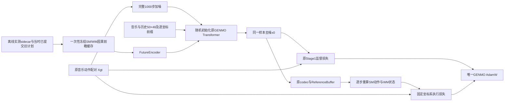

# 从零音乐扩散与可微物理执行约束

本方法独立于旧Stage2：静态构造随机GENMO，原60帧监督与同一样本去噪x0的执行损失
共用一个优化器、一个run。没有GENMO权重初始化、生成教师、Critic或终点价值。

2026-10-27实际基线：`4a005d14d7e523d43959c21d3a6364de79653462`；
只读SM bridge：`d9164b0e15934806ff8d750ff70911949c7f5171`。
独立工作树：`/home/weili/bumi-closedloop-worktrees/joint-physics/GENMO`；
分支：`feature/joint-diffusion-physics-from-scratch`。原共享分支与运行进程保留。

本轮只做有界验收，没有启动长期八卡训练。代码可运行、导数接通和实际优化更新都不能
代替自由生成或全曲物理收益；最终实测见同目录验收报告。

2026-10-27追加要求已落实为当前默认：物理状态和请求前瞻一次性离线生成，训练随机读取
持久化v2缓存；新执行Loss软关节限位关闭，`lambda_safety=0`，原监督限位不变。
默认H32、独立审计H32/H64；旧H8/H16结果不授权新时域。后续训练目标为Server-2，
使用`configs/closedloop/joint_physics_server2.yaml`。有旧任务占用时不抢占其GPU。

## 算法与复用边界



- `training.build_stage1_actor`只承担静态构造；没有调用旧GENMO权重加载函数。
  Transformer最大长度仍120，但Dataset和监督入口都强制实际60帧；qpos30/contact2不变。
- `Stage1Actor`提供归一化、1000步cosine扩散、x0预测、音乐dropout、逐坐标前缀约束；
  `Stage1BumiLosses`提供原表示/FK/接触/速度/加速度/jerk/脚滑/穿地/限位监督。
- 新`JointPhysicsActor.denoise_supervised`将FutureEncoder加入监督条件融合。
  原`ForecastActor.original_supervision`仍保留为历史研究实现，新流程不调用它。
- `mb_control.sampler`提供完整20步DDIM、eta=0、CFG=2.5，CFG只改变音乐。
  每次采样结束恢复所有子模块原train/eval状态。SM/WM独立于GENMO模块树，永远eval。
- 复用原codec、SM FK、旋转、插值、速度halo、`SMAdapter`、`ReferenceBuffer`、
  `forecast_rollout`、`PhysicalCollector`与`Scheduler`。不复制SM网络或执行器参数。
- 没有FrozenStage1Teacher、Local/Global生成教师、Critic、终点价值、PPO/DPPO/AWR/
  RoboFFT、残差动作网络或latent输出；EMA首版未实现。

`initialization.mode=random`、`pretrained_genmo=null`。旧架构的零初始化投影原样保留；
所有优化器、scheduler、辅助损失和物理课程从新run step0开始。原stats/FK可以只读复用，
即使stats文件所在历史目录含有旧模型，也不会加载那个模型文件。

## 新文件职责

| 模块 | 职责 |
|---|---|
| `config.py / contracts.py` | 静态架构、资产装配、600Hz与局部窗口合同 |
| `actor.py` | 监督与DDIM共享Future条件、噪声/mask身份、模式恢复 |
| `data.py` | 原数据来源加权采样、全曲随机公共网格裁剪、sidecar内容校验 |
| `prepare_rollouts.py` | 冻结SM在真实Newton中的连续原动作跟踪和紧凑分片 |
| `offline.py` | 一次性生成公共网格请求条件、预测状态与索引；既有真实缓存无仿真转换 |
| `reference.py` | 请求快照、旧计划可见性、首次影响真实起点与候选参考 |
| `execution.py / losses.py` | 冻结执行链、支持域拒绝、物理尺度与有效窗口归一化 |
| `curriculum.py / trainer.py` | 完整监督噪声、物理子批、唯一AdamW、同步DDP与计数 |
| `checkpoint.py` | 新schema完整恢复、每rank全部采样/RNG状态和不覆盖发布 |
| `evaluation.py / entry.py` | 三类独立评价、新目标Newton方向和前瞻验证、CLI |

对应四个`tools/*joint_physics*.py`入口、四份`configs/closedloop/joint_physics*.yaml`、
`tests/closedloop/joint_physics/`与`scripts/train_joint_physics.sh`均独立于旧Stage2。

## 数据与sidecar合同

配对库、文件、原train/val/test清单不改动。来源权重沿用原四库；源内沿用duration-aware
展开权重。裁剪覆盖全曲并落到公共网格：Stage1源帧乘20得到600Hz tick，控制步乘12；
3个源帧等于5个控制步。绝不混用原Stage1内部150Hz历史构造整数与在线600Hz整数。

每个sidecar索引按`[dataset_id, split, sample_id]`定位分片/episode，再按全局tick和版本
读取。原音乐、动作内容SHA必须匹配，验证/测试缓存不能作为训练缓存。

| 保存内容 | 语义 |
|---|---|
| `state[N,55]` | 实际Newton观测，非GT姿态 |
| `observation[N,75] / proprio[N,48]` | 当时实际SM观测与GENMO历史；按时间索引还原10/50帧 |
| `previous_action / action / xi25` | 已执行动作、上一动作及真实执行器外生量 |
| `visible_upper / plan_version / committed_tick` | 请求时已可见旧计划的范围、版本及提交时刻 |
| `reference_qpos / source_versions` | 每首一次的原数据参考与源点版本；不重复保存整首音乐 |
| `contacts / termination_reason` | 求解器真实接触和连续轨迹结束原因，失败不复位拼接 |
| `assets / dataset / motion_sha256 / music_sha256` | 同源SM/WM、执行器、stats、FK、时钟及原划分身份 |
| `offline_requests` | frame/prefix/forecast_tick、58维条件、有效性/失败原因、预测状态紧凑偏移表 |

采集只在episode起点reset一次。参考地面使用原地面元数据作一次固定Z变换，动作与实际
状态始终处于同一确定坐标系。teacher-forced旧计划在采集期间按显式版本预先提交；
训练不能从本次待预测标签扩展旧缓存。缺少sidecar时Future贡献严格为零，示范历史保留
`causal_demo_kinematic_proxy_not_actual_gmt_rollout`来源。

sidecar包含真实未来状态，用于局部窗口起点/验证；请求条件只由请求时真实历史和旧计划
经冻结WM预测。无泄漏测试修改未知未来标签/contact/地面监督后，历史、旧计划和Future
条件逐元素不变。contact与地面标签不会成为Actor输入。

当前schema为`genmo.joint_physics.sidecar.v2.offline_requests`。分片使用只读mmap，先按
source ID定位episode，再按`frame//3`随机读取；历史使用控制步索引，预测状态使用偏移表，
不为每个请求复制整曲。前缀采样合同必须一致。训练不运行Newton、不调用WM预处理前瞻、
不生成或回填sidecar；WM只运行保留梯度的候选执行链。旧v1只能显式离线转换到新目录。
真实读取测试将`WM.step_model`替换为报错函数，检查训练取样确实没有在线预处理。

```bash
python tools/prepare_joint_physics_data.py --config <cfg> --split train \
  --import-sidecar <raw_v1_sidecar> --output <new_v2_offline_sidecar>
```

## 执行损失与有效性

首版仅`physics.prediction_mode=denoised_x0`；物理子批使用同一次监督去噪结果，没有训练
完整DDIM反传链。每一步重新构造SM观测、历史与previous_action并运行SM得到新动作，
再用同一个WM推进状态。起点与目标detach，候选参考、动作和预测状态保留梯度。

目标为同源数据动作。根位姿保持固定世界坐标；身体位姿转到根坐标以避免重复计算yaw。
每个物理误差按配置中明确的米、弧度和速度尺度计算稳健损失；窗口按有效折扣质量求均值，
改变H不会隐式放大相对BC权重。实际执行限位只记录诊断，不再形成新软限位Loss；
`L_exec_safety=0`、`lambda_safety=0`、Action Rate=0。原监督参考限位保持不变。

物理课程只筛选执行子批，监督仍均匀覆盖1000步。SNR由实际`alphas_cumprod`计算。
音乐被drop的样本保留完整监督，但不给它施加某一首特定舞蹈的执行目标。缺缓存、保护区
冲突、时间/速度支持不足、退化旋转、WM/动作超域、无新参考影响和不完整窗口分别记录。
不把坏预测替换为GT，不放宽支持域让学生通过。

只用候选首次影响之前的真实状态作局部起点。报告分别保存preview-only步数、中心消费
步数、结构支持源点和覆盖率。H32/H64分别为0.64/1.28秒控制，H8/H16历史对照仍可配置。
这些短窗不代表完整60帧舞蹈、多决策BPTT或完整反事实全曲梯度。

新Newton报告必须匹配本方法执行目标/资产，H32/H64分别实际检查；另外核对真实请求起点
的因果前瞻误差。源码提交仅追溯，不作为正确性门禁。首次报告的原始测量与补充合同报告
分别保留，后者只读取该次已记录输入manifest，不改变原始方向结果或阈值。

## 优化、恢复和DDP

唯一AdamW包括所有可训练GENMO主干、音乐、历史、前缀与FutureEncoder参数；SM/WM无
优化器。首版FP32验证，混合精度尚未开放。正式候选LR=1e-5，物理权重逐步增加；验收
配置可缩短warmup，但A/B使用同一初始seed、模型、输入、数据顺序和监督样本预算。

DDP每个rank执行相同forward/backward；执行子批梯度乘`world_size/global_valid_count`，
使DDP平均后等于全局有效样本均值。无有效样本rank使用图内零项，全零也不跳过backward。
单卡诊断间隔分解data/exec对Future和主干的梯度；DDP可用独立审计入口作细分诊断。

新schema：`genmo.joint_diffusion_physics.v1.checkpoint.v1`。保存Actor、唯一AdamW、scheduler、
global_step、课程、每rank数据游标/PCG64、独立噪声与窗口随机流、Python/NumPy/CPU/CUDA RNG、
资产与划分身份、验证合同及监督/物理计数。只接受本schema完整恢复；旧Stage2不能weights-only
冒充继续训练。文件原子发布且不覆盖，恢复也写入新的输出目录。

## 实际命令

在新工作树运行；使用已安装torch、GENMO依赖及SM Newton桥接的环境。服务器1可令
`JOINT_PYTHON=/data0/user/liwei/envs/genmo_adapter_runtime_20261026/bin/python`。
正式配置用`joint_physics_from_scratch.yaml`；有界实测用`joint_physics_server1_acceptance.yaml`。
所有`--set`只覆盖本次运行，不改共享数据/配置文件。

```bash
python tools/prepare_joint_physics_data.py --config <cfg> --split train --output <new_sidecar>
python tools/prepare_joint_physics_data.py --config <cfg> --split val --output <new_val_sidecar>

# 新目标接口/动力学验收；此结果本身不算学生更新成功。
python tools/audit_joint_physics_gradients.py --config <cfg> \
  --set data.sidecar=<train_sidecar> --interface-probe --newton --output <new_audit>

# A/B共享相同缓存、验证筛选和预算；A只关闭执行约束。
python tools/train_joint_physics.py --config <cfg> --mode smoke --max-steps 100 \
  --set data.sidecar=<train_sidecar> --set physics.validation_report=<validation.json> \
  --set physics.enabled=false --output <new_A>
python tools/train_joint_physics.py --config <cfg> --mode smoke --max-steps 100 \
  --set data.sidecar=<train_sidecar> --set physics.validation_report=<validation.json> --output <new_B>

python tools/audit_joint_physics_gradients.py --config <cfg> --checkpoint <joint.pt> \
  --set data.sidecar=<train_sidecar> --newton --output <new_student_audit>

python tools/evaluate_joint_physics.py --config <cfg> --checkpoint <joint.pt> \
  --set data.sidecar=<val_sidecar> --mode reconstruction --output <new_reconstruction>
python tools/evaluate_joint_physics.py --config <cfg> --checkpoint <joint.pt> \
  --set data.sidecar=<val_sidecar> --mode free_generation --output <new_free_generation>
python tools/evaluate_joint_physics.py --config <cfg> --checkpoint <joint.pt> \
  --mode closed_loop --output <new_closed_loop>

# 以下提供正式入口，本轮没有启动长期训练。
JOINT_GPUS=1 bash scripts/train_joint_physics.sh <cfg> --max-steps 600000 \
  --set data.sidecar=<train_sidecar> --set physics.validation_report=<validation.json> --output <new_run>
JOINT_GPUS=8 CUDA_VISIBLE_DEVICES=0,1,2,3,4,5,6,7 bash scripts/train_joint_physics.sh <cfg> \
  --max-steps 600000 --set data.sidecar=<train_sidecar> \
  --set physics.validation_report=<validation.json> --output <new_ddp_run>
JOINT_GPUS=1 bash scripts/train_joint_physics.sh <same_cfg> --resume <complete_joint.pt> \
  --max-steps 600000 --set data.sidecar=<same_train_sidecar> \
  --set physics.validation_report=<same_validation.json> --output <new_resume_run>
```

`max-steps`是绝对global_step上限，必须大于恢复步数。正式全量任务需要准备对应全量缓存
并扩展真实验证覆盖，不能把两首歌的有界报告当成全库覆盖。CLI的`--max-sources`和
`--max-control-steps`只用于明确有界验收；默认closed_loop尝试跑完整音乐，失败/超时原样记录。

## 三类结果的解释

- reconstruction：固定同一GT、噪声等级和epsilon，记录原监督误差及真实短窗执行误差。
- free_generation：纯噪声完整DDIM；记录生成活动度、同模型跨seed多样性、音乐条件敏感性
  和真实执行。没有把任意生成舞蹈硬配给一条GT作逐帧评分。
- closed_loop：从真实历史连续生成和真实接管，采用实际墙钟到达时间；记录整曲完成、
  终止原因、时长、提交/超时、物理活动和节拍。独立模型同seed不保证相同舞蹈身份。

验收测试、GT接口方向、学生有效更新和方法收益必须分别报告。有限短测的损失下降或
有限非零梯度不代表自由生成改善、全曲完成或实机稳定。
