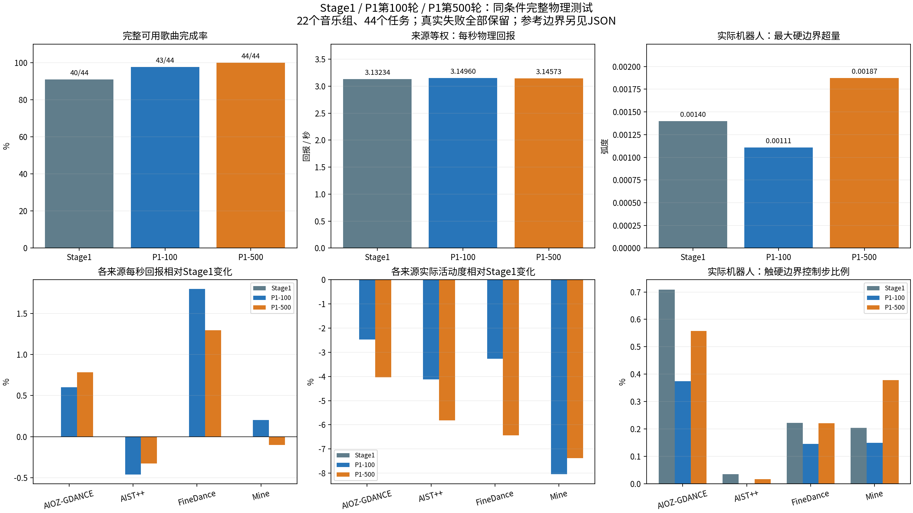
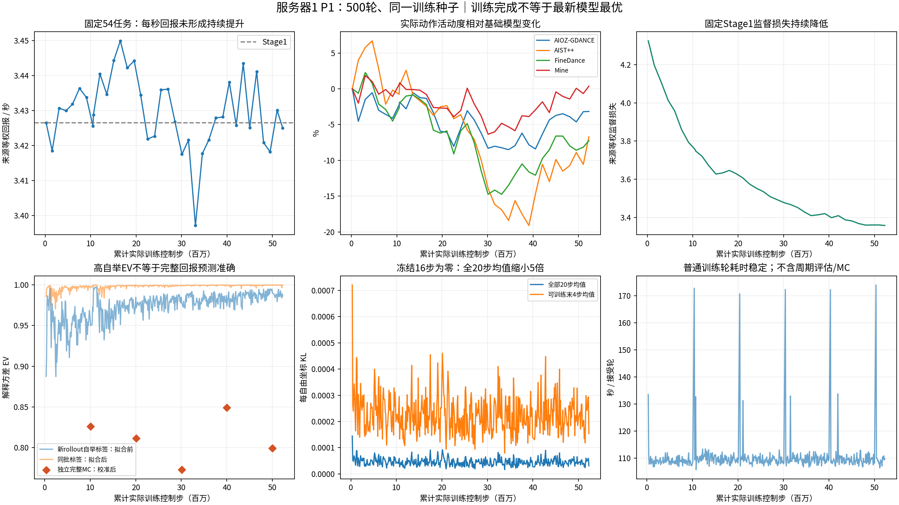

服务器1第500轮训练、基础模型对照与本机部署复核
================================================

结论与范围
----------

2026年10月16日现场核验：原P1正式训练按累计500轮正常结束。最新模型在相同
Isaac测试合同下，将完整可用曲段的完成数从Stage1的40/44提高到44/44，来源等权
积分回报提高3.004%。这支持本组长时间执行能力改善；每秒回报只提高0.428%，
音乐簇配对95%区间跨零，不能称为整体运动质量显著提高。

与此同时，实际活动度降低5.812%，同一时间范围的根位置跟踪RMS增大25.617%，
最严重的实际关节硬限位越界增大33.929%。最新500轮也不是短验证选出的best：
best保存于158轮。当前结果更符合“部分长曲稳定性改善，但动作更保守、某些
空间及尾部指标退化”，不支持直接继续堆训练轮数或宣布全面优于Stage1。

进一步对照冻结GMT第一阶段的实际训练配置与第500轮采样器状态，确认普通DPPO
采集存在时间位置覆盖缺口：FineDance累计只有79.631%的可用时间位置进入过
Actor物理采集。随机选曲、从头连续执行没有实现随机时间位置覆盖；新增证据和
改进优先级见下文“对照GMT第一阶段：采样、状态与训练目标”。

本机MuJoCo对两个模型分别进行了12秒真实物理短测，均有末端相对高度阈值告警。
500轮模型严格时延余量标定也未通过，实际短段以best_effort连续运行；虽然本段
实时因子接近1且无参考耗尽，仍不能宣布sim2sim物理与实时余量全部通过。

此报告的基础模型是本次Stage2实际绑定的Stage1 ``s595000.pt``，不是未核验的
其他Stage1末轮。GENMO工作分支为 ``feature/bumi-music-closedloop``，配套GMT为
``feature/bumi-frozen-gmt-backend``。本次没有改变奖励、学习率、优化器、训练
算法或恢复长期训练。

训练是否正常
------------

正式阶段从100轮恢复到累计500轮，2026-10-15 10:47:50（北京时间）启动，退出0；
由启动时间和实测52321.583秒耗时计算，于2026-10-16 01:19:52结束，耗时约
14小时32分钟。现场GPU空闲是完成后的状态，不是训练卡死。独立整曲评估另耗时
755.439秒、退出0；11:10复查没有残留GPU计算进程。

* 两个连续会话均status=passed、exit_code=0；累计计数严格衔接。
* 累计接受500轮、Actor更新3996次、Critic更新68064次；训练控制步52284455，
  物理步209904032，上层转移2002036。不同计数包含的预热/重置范围不同，不用
  全局计数之比代替每一控制回复的四物理子步完整性校验。
* 500轮没有硬回退、软停止；优化时物理暂停，正常采集边界重置0次。
* 前16步使用独立冻结Stage1，KL始终为0；末4步可训练，全部20步最终检查通过。
* 正式400轮日志Traceback、CUDA OOM、ChildFailedError均0；接受400、拒绝0。
  训练源代码、GMT模型与运行资产冻结检查通过，关闭ACK与最终checkpoint一致。
* 固定Actor学习率1e-7；每轮BC样本512，500轮共256000。没有仅因学习率为小值
  就将更新判为无效，也没有将接受计数当作质量提升证据。
* 训练采样共出现3726次物理失败事件，按100轮分组为808/715/819/685/699。
  这是不同任务的重复事件计数，不是失败率；训练中的探索失败不能与固定测试
  的44个任务直接相除，也不能因进程正常退出而忽略。

普通接受轮平均110.240秒，中位109.326秒，范围105.788至173.944秒；采集49.198秒、
Actor32.190秒、最终KL24.388秒、Critic2.819秒。这些不含周期评估和MC额外开销。
最终KL占普通轮约22.1%，属于明确可定位的开销。记录的PyTorch峰值分配14.546GiB、
保留19.867GiB不包含全部PhysX/驱动内存，不等于整卡显存峰值。

评估口径与统计边界
------------------

短验证使用固定27个音乐组、每组2个种子，共54任务，每个最多约10秒。实际配置
``start_mode=mixed``，按来源内样本交替选择开头和居中窗口；原始记录中30任务
起点为0、24任务起点大于0（2.5至58秒）。居中窗口起点为
``max(0, (num_frames - 10*30)//2)``，不是每轮随机抽取位置。37份评估的计划SHA、
任务身份、音乐起点及噪声起点全部相同。因此“每次只考前10秒”是不准确的表述；
这里固定的是独立短窗口，部分位于音乐中段。54任务虽均无物理失败，实际52个由
``physical_safety_limit`` 行政时间上限结束、2个music_end，不能称54首完整歌曲
全部成功。500轮共有37份评估记录，保留恢复前后的全部证据。

训练采样另有独立配置：按来源概率和打乱后的样本顺序选曲段，但本次
``stage10.dataset.random_start=false``，每个新episode从所选数据曲段起点开始。
正常episode跨4秒采集窗口连续保留状态，直到歌曲结束或失败；10秒是周期评估
上限，不是训练只采前10秒。固定验证任务有利于配对比较各checkpoint；扩展起点
覆盖可先随机抽出多组窗口再固定，同时用连续完整曲段评估累积误差。

独立test使用22个音乐组、种子42和1729，共44任务：AIOZ14、AIST++8、FineDance12、
Mine10。执行每个配对数据源的完整可用曲段直到数据终点，不使用10秒上限；不意味着
原始商业歌曲文件从头到尾都在数据集中。Stage1及100轮复用此前保存且通过合同
核验的物理原始证据；500轮本次在服务器1新跑。任务、随机核、资产、时序及物理
合同一致，500轮124996控制步、499984物理子步经过权威journal SHA与逐步完整性核验。

所有模型在此Isaac对照均使用同一训练采样核：20步、eta=0.1、CFG=2.5，噪声下限
``[0.001]*16+[0.08,0.10,0.12,0.12]``，前16步冻结Stage1、后4步当前模型。
500轮44任务均music_end，无物理失败、基础设施失败、计划拒绝或截止超期。

回报/活动度先在各来源内平均，再对四来源等权。置信区间使用20000次来源内音乐簇
配对bootstrap，同曲两个种子作为同簇，不当作44首独立音乐。此为一个训练种子的
结果，不包含多次独立训练方差，也不证明这些曲段对Stage1预训练完全未见。

完整可用曲段对照
----------------

.. list-table:: 固定44任务；回报与活动度按来源等权，完成数为任务原始计数
   :header-rows: 1
   :widths: 37 21 21 21

   * - 指标
     - Stage1 s595000
     - P1第100轮
     - P1第500轮
   * - music_end / 总任务
     - 40 / 44
     - 43 / 44
     - 44 / 44
   * - 物理阈值失败
     - 4
     - 1
     - 0
   * - 积分回报
     - 163.55055
     - 166.85591
     - 168.46366
   * - 每秒回报
     - 3.132340
     - 3.149598
     - 3.145733
   * - 实际活动度 / rad/s
     - 0.930239
     - 0.889645
     - 0.876169
   * - 实际硬限位控制步占比
     - 0.35706%
     - 0.20847%
     - 0.34641%
   * - 实际最大硬限位越界 / rad
     - 0.00139828
     - 0.00110990
     - 0.00187270
   * - 已执行参考硬限位控制步占比
     - 4.01262%
     - 3.82036%
     - 2.41288%
   * - 已执行参考最大硬限位越界 / rad
     - 0.229631
     - 0.322386
     - 0.231082

边界占比为“至少一个关节越界的真实控制步数/全部控制步数”，不是越界关节比例；
本表边界行按所有控制步加权，不能与来源等权占比混用。来源等权实际硬限位占比为
0.292607%到0.293860%，略增0.428%；因此总体占比略降也不说明各来源都改善。

500轮相对Stage1：积分回报差+4.91310，95%区间[+0.50642,+9.76484]；每秒回报差
+0.013393，区间[-0.011350,+0.039986]；活动度差-0.054070rad/s，区间
[-0.070434,-0.037710]。长曲多执行时间贡献了一部分积分收益；活动度下降的证据
比每秒回报提升更明确。100轮到500轮每秒回报反而略降，不是单调进步。

恢复的4个任务来自FineDance两首曲段：060两种子，基础模型在100.56/99.60秒因
yaw_anchor_ori终止，最新完成117.46秒；201两种子，基础模型在163.30/173.36秒
终止，最新完成177.02秒。最新没有新失败。此终止条件是姿态跟踪阈值，不把每次
失败都称为实际跌倒；恢复集中于两首音乐，不能由44/44推断零泛化失败率。

按来源每秒回报变化：AIOZ +0.785%、AIST++ -0.326%、FineDance +1.295%、Mine
-0.101%；活动度变化分别-4.032%、-5.819%、-6.432%、-7.374%，四来源均下降。

原始跟踪与音乐质量
------------------

为排除“最新模型多跑了后半段”带来的统计混杂，将500轮每个任务截到该任务
Stage1实际结束时刻，共比较相同122389控制步。RMS定义为原始逐控制步平方误差
均值开方，衡量真实机器人相对其GENMO参考的跟踪，不是相对原始舞蹈的保真度。

.. list-table:: 相同任务、相同时间前缀的真实跟踪误差
   :header-rows: 1

   * - 指标
     - Stage1
     - 第500轮
     - 相对变化
   * - 根/锚点姿态RMS / rad
     - 0.534066
     - 0.310163
     - -41.924%
   * - 根/锚点位置RMS / m
     - 0.474583
     - 0.596157
     - +25.617%，变差
   * - 身体姿态RMS / rad
     - 0.152662
     - 0.148700
     - -2.595%
   * - 身体位置RMS / m
     - 0.030708
     - 0.029706
     - -3.261%
   * - 关节位置RMS / rad
     - 0.099539
     - 0.097749
     - -1.798%
   * - 关节速度RMS / rad/s
     - 1.232217
     - 1.218943
     - -1.077%

来源等权每秒tracking奖励1.780905到1.773766略降；stable从0.912694到0.915100，
joint_limit惩罚从-0.043968到-0.030189，contact从-0.011586到-0.010652。奖励
改善主要体现于部分约束和长时间存活，不能概括为全部跟踪误差下降。

活动度是0.5秒因果窗内关节速度的RMS，再对控制步及来源平均；不是角度振幅本身。
实际加速度RMS约16.602到16.220rad/s²、jerk约874.092到853.558rad/s³略降，
可伴随动作缩小，不能单独证明动作更自然。完整生成proposal的加速度RMS约92.053
到92.002、jerk约4998.691到4998.968，基本无改善；proposal与实际执行统计分开。
音乐同步诊断0.687411到0.685827略降；训练音乐奖励关闭，仅保留音乐条件、CFG和
BC监督，没有足够证据称音乐匹配提高。也没有证据称策略已经退化为站立。

短验证、监督损失与选模
----------------------

.. list-table:: 固定54短任务的来源等权统计
   :header-rows: 1

   * - 模型
     - 积分回报
     - 每秒回报
     - 活动度 / rad/s
   * - Stage1
     - 34.097254
     - 3.426497
     - 0.861428
   * - P1第100轮
     - 34.121037
     - 3.428743
     - 0.855323
   * - P1第158轮best
     - 34.329605
     - 3.449897
     - 0.847083
   * - P1第500轮
     - 34.083022
     - 3.424977
     - 0.826246

500轮每秒回报相对Stage1 -0.0444%，差值95%区间[-0.020231,+0.017281]，无明确
提升；活动度下降4.084%。158轮每秒回报高0.683%，但它是在反复使用同一验证集
的37份记录中选出的最高值，其配对区间不能消除选模偏差；本次未做158轮完整test，
不将它认定为长曲最优，也没有用best替代用户要测试的最新500轮。

固定43个Stage1监督验证样本的来源等权损失从4.325126降至3.357998，改善22.361%，
四来源均下降。该指标说明原监督任务的拟合改善，不能替代物理或舞蹈质量验收。

Actor与Critic诊断
-----------------

最终全20步每自由坐标KL均值跨轮平均4.51526e-5，可训练末4步均值2.25763e-4。
前16步为0导致全20均值恰好缩小5倍；最大单步均值跨轮最高0.00120893，仍低于
配置0.01。全20最终检查objective_clip_fraction平均0.05358%，优化器步骤的
ratio越界比例平均0.02171%、实际作用于目标的clip比例0.01949%，中位数均0。
当前代理比值通常接近1，PPO裁剪很少激活。

原始梯度范数均值0.68077、最大2.18198，偶有裁剪但没有持续爆炸证据。
加权BC梯度/PPO梯度范数比中位0.09984、95分位0.24689、最大3.002；平均梯度
余弦接近0。这不支持“整个训练被BC梯度完全压制”，也不等同Adam参数更新比例。
梯度SNR诊断未启用，值为None而非0；归一化优势导致PPO loss近0，不能据此判断
没有学习。按100轮的训练每秒回报为3.1651/3.1834/3.1623/3.1892/3.1641，大体
横盘，但训练任务混合会变化，这些不是严格配对的因果曲线。

Critic同批自举目标拟合后的EV可接近0.9995，不能代表完整回报预测如此准确。
第500轮同批MSE由21.4919降到0.49957、EV由0.98615到0.999679；固定初始自举
标签上的EV由0.95358降至0.80390、MSE由33.634到142.913，说明分布/目标漂移。
当前新物理短验证的自举目标EV=0.96784，也不是无偏真实价值。

完整独立MC在97/193/289/384/480轮检查，校准后EV约0.826/0.812/0.773/0.849/0.799。
384轮候选MSE变坏，正确拒绝并恢复原Critic。480轮独立32任务、3376转移：MSE
555.106到534.411，只改善3.728%；预测均值68.447、MC均值79.262，仍低估约10.816。
这些结果提示长时间价值预测仍有明显偏差。MC验证用于选择混合候选，因此也不能
宣称是从未参与选择的最终价值测试集。

周期报告 ``quality_gate_passed=false`` 与 ``refit_accepted=true`` 可同时出现：
前者沿用初次预热的相对MSE改善至少30%等质量门槛，后者按周期逻辑只要求候选MSE
优于当前模型。源码明确如此，不能误报为回退逻辑失效；但应把“接受少量改善”和
“达到价值质量目标”分别监控。

由结果定位的代码问题与优先级
----------------------------

1. 选模连续执行时长与长曲失败不匹配。``configs/closedloop/stage10_server1.yaml``
   使用开头/居中的固定窗口，``stage10.evaluation.episode_seconds=10`` 只连续
   执行10秒，无法评估连续运行约99秒以上累积的状态误差。这里的限制是连续物理
   执行时长，不能误称只测试歌曲前10秒；直接从中段重置开始也不等价于连续跑到中段。
   ``gem/closedloop/dppo/periodic_monitor.py:choose_best`` 按失败总数、平均执行
   时长、整体活动度至少80%和标量reward选模；虽报告paired_new_failures，却未将
   新增失败集合、全局位置漂移和硬限位尾部写入资格门槛。应为长曲、位置及边界
   建立独立验收，同时保留短验证作日常监控；不能把158轮短best当正式部署best。

2. 限位奖励丢失严重程度。``gem/closedloop/dppo/rewards.py:_joint_limit`` 与
   ``vector_reward_math.py`` 将每关节成本裁到[0,1]再取21关节最大值，到达硬边界
   后继续越界不会增加该关节成本，多个关节同时违规也不一定增加最终成本。当前
   已执行参考违规占比下降39.868%，实际最严重越界却增加33.929%，与此目标盲区
   一致，但不是单独因果证明。下一轮应显式处理硬边界外距离及尾部指标，并分别
   报告实际/已执行参考/完整proposal，修改后使用新训练身份。

3. 活动度与音乐质量保护偏弱。``rewards.py:_activity`` 的full_gate_ratio=0.5，
   达到配对活动度一半即得到满tracking门控；``choose_best`` 允许整体活动度下降
   20%。模型活动度下降5.8%仍可轻易通过。音乐奖励关闭意味着当前Stage2不直接
   优化同步诊断。需要明确允许的动作收缩与音乐质量约束，并分来源检查，不能只
   看总reward提高。活动度下降是实测，原因仍需有控制的消融。

4. PPO与KL口径需同时展示。``gaussian_probability.py:ppo_surrogate`` 使用
   exp(联合log-ratio/自由坐标数)代理，而非联合密度比；``updater.py:final_kl``
   同时保留全20步、逐步和最大步KL。全20步平均被16个冻结零值稀释，不宜据此
   判断末4步几乎没有改变。最大步门禁仍有效，并非没有策略距离保护。裁剪稀少、
   回报横盘提示需要检查代理尺度、优势质量和有效更新方向，但不足以直接得出
   “增大学习率即可改善”的结论。

5. 价值预测仍有偏差。``mc_calibration.py:calibrate_critic`` 的周期接受门槛只
   要求验证MSE变好；``pretrained_critic.py:_encode`` 使用冻结Stage1音乐、前缀
   和真实本体历史编码，加剩余时间预测价值，没有直接输入历史GMT参考误差。
   历史参考跟踪上下文不足是可能因素，尚无消融证据确认。优先监控完整MC误差、
   偏置与分来源校准，不能用同批自举EV接近1宣布Critic问题解决。

6. 训练与部署分布不同。``gem/closedloop/sim2sim/runtime.py:InferenceActor``
   先严格重建checkpoint的随机训练核，再构造20步eta=0部署核，仅初始噪声随机；
   训练末步std=0.12而部署不加末步噪声。前16步仍使用Stage1，末4步使用当前模型。
   本次训练/Isaac测试已知前缀17帧，本机标定为22帧，且物理后端不同。原生采样
   对照通过只证明实现正确，不能证明分布变化后物理质量保留。部署验收应使用
   实际eta=0、实际标定和MuJoCo完整曲目，分开定位生成、GMT和物理资产问题。

7. 审计与真实测试覆盖缺口已修复。旧审计工具只接受一个完整会话，不能直接正确
   汇总100→500的恢复训练；简单拼接还会把早期final的横轴错误画到500轮终点。
   本次新增严格多会话计数/发布核验及所属会话控制步；原来已有20倍总数校验，
   本次补充非零链数和逐步0..19完整性，不将原实现误称为没有KL覆盖检查。
   真实测试此前硬编码3个旧模型和末步0.03；现按两模型配置运行，并独立核验
   最新冻结16+可训练4的原生DDIM，观测两套denoiser的全部真实调用。

对照GMT第一阶段：采样、状态与训练目标
------------------------------------

本节核对的是当前冻结跟踪器 ``model_140500.pt`` 的GMT第一阶段训练，不是上层
GENMO的Stage1 ``s595000.pt``，也不是GMT源码中另外存在的StageII片段课程。
实际训练目录为：

::

    legged_lab_gmt/logs/rsl_rl/tracking_bumi4340_mha_sonic_mimic/
      2026-09-28_20-12-58_umr_soma50_six50_filtered_scratch

本次逐一核对 ``params/env.yaml``、``params/agent.yaml`` 与140500导出报告绑定的
SHA。环境配置SHA为 ``96c67389fd5c49379b974692fe29e27687b247578d06a68c280b58686bc70a72``，
算法配置SHA为 ``b633ab8ab057b9915a78424e0239cbea3ecd9e3a5ecc0c9b55c645699a6533b6``。
``stage2_split_manifest=null``，实际使用Stage-I采样分支。现场还核对了noetix-volc
与本地的 ``mdp/commands.py``、``tracking_env_cfg.py``、
``env/manager_based_rl_mimic_sonic_env.py``，三个文件SHA一致；远端没有Git目录，
这里验证的是文件身份，不声称验证了远端Git提交。

为什么关闭random_start
~~~~~~~~~~~~~~~~~~~~~~

历史提交 ``e867e3ace3705453d53095ba86182c4eaa099006``，2026-10-13 13:01:18，
标题“阶段B分离物理歌曲与采集窗口并加入完整MC价值预热”，在引入
``physical_episode``、4秒 ``ppo_rollout`` 和完整MC校准时，将
``stage10.dataset.random_start`` 从true改成false。同次日志明确写的是默认从
歌曲开头执行到结束或失败，PPO片段边界不重置正常物理状态。

因此这是一项把普通训练集中于“从头连续执行”的设计选择，不是DPPO或完整MC
算法要求。``mc_calibration.complete_mc_plan`` 自行生成从开头执行到终点的
独立任务，不读取普通训练的 ``dataset.random_start``。随机时间位置训练与
从头整曲MC可以并存。本次没有查到随机起点与固定起点的配对消融能证明关闭更好。
保留跨rollout物理连续性本身合理，但它不能代替时间位置覆盖。

GMT第一阶段实际如何抽样与初始化
~~~~~~~~~~~~~~~~~~~~~~~~~~~~~~

``mdp/commands.py`` 将全部动作划成约1秒的时间bin。在normal与whitelist各自
的集合内，以90%均匀分布混合10%困难度分布，抽bin后再随机抽bin内帧，并随机
向前回退0至100帧（50Hz下最多2秒）。normal与whitelist的任务配额各半。
困难度来自终止所在bin的失败/episode计数，经平滑、上限和EMA处理，每轮PPO
更新后同步；它不是对每个经过bin都统计暴露次数，不能夸成无偏真实失败风险。
这些源码行为与保存配置相符，不根据源码中的论文说明推导未经核验的论文结论。

抽到时间帧后，``MotionCommand._resample_command`` 把该帧的根位置、姿态、
根线/角速度、关节角度和速度写入仿真，再加入位姿/速度扰动。关节角扰动为
±0.1rad，随后裁到软限位。也就是说，GMT会让机器人从动作中段的相应状态开始
练习，不需要每次先通过整段前奏才能练到后面的动作。

保存配置的物理episode上限为20秒，PPO每次收集24个控制步，即0.48秒；正常
PPO采集边界也不等于物理reset。因此不能把DPPO的4秒rollout本身判为错误，
也不能认为只有整曲都进入同一个优化batch才算训练长曲。两者的动作与折扣时间
单位不同，GMT的学习率、clip和gamma数值不应直接照搬到上层扩散策略。

GMT的Critic还接收实际根线速度、目标速度/关节状态、根相对参考位置与姿态、
实际身体位置与姿态等信息。环境保存配置包括物理参数、初始状态、观测噪声、
外力扰动及课程；保存配置本身不证明第140500轮所有课程已达到最大强度。

第500轮的实际覆盖与来源比例
~~~~~~~~~~~~~~~~~~~~~~~~~~

从不可变第500轮完整checkpoint读取8个rank、512个sampler，全部
``random_start=false``；重新核对四个train清单SHA与checkpoint身份一致。
普通Actor采集累计49859347控制步、2002036上层转移，后者与训练累计计数相等。
本节不包括独立MC、BC或Stage1预训练，不把“未进入普通Actor物理采集”说成
“模型从未见过这份数据”。

跨slot合并每个样本的已执行时间区间，然后除以各来源全部可执行时间，得到下表。
来源比例是转移样本占比，不是精确的梯度贡献比例。配置概率明示针对任务次数，
因此实际份额不同不是采样器违反自身概率合同，而是当前混合目标与优化数据份额
需要重新审视。

.. list-table:: 普通Actor采集的来源与时间覆盖
   :header-rows: 1
   :widths: 20 14 14 18 18 16

   * - 来源
     - 配置选曲概率
     - 实际选曲占比
     - 上层转移占比
     - 已执行样本/总数
     - 时间位置覆盖
   * - AIST++
     - 20%
     - 20.09%
     - 4.71%
     - 351/351
     - 100.00%
   * - AIOZ-GDANCE
     - 35%
     - 35.02%
     - 29.29%
     - 3260/3745
     - 85.68%
   * - FineDance
     - 25%
     - 25.23%
     - 43.45%
     - 102/102
     - 79.63%
   * - Mine
     - 20%
     - 19.65%
     - 22.56%
     - 89/89
     - 99.71%

FineDance的102个训练样本虽全部被执行过，但只有61个被覆盖到可用时间末尾，
41个未覆盖完整，12个连一半都没有覆盖到。最明显的两个例子：

* ``047`` 可执行251.4秒，48个不同slot记录过执行，累计最远只到49.8秒，
  即19.81%；后201.6秒没有进入普通Actor物理采集。
* ``051`` 可执行130.7秒，56个不同slot记录过执行，累计最远只到31.0秒，
  即23.72%。

slot数量不是失败次数；合并区间也不能还原每次episode的终止原因，不能把第一
个例子说成“48次都在49.8秒失败”。有限训练末尾和恢复边界也会造成部分任务
未完成。已经能确定的是，重复选中长曲没有保证其后段进入普通Actor训练；从头
开始使后段学习依赖此前整段执行，而随机时间位置可以提供直接进入后段的路径。

AIOZ还有485个样本没有进入普通Actor物理采集。每个slot各自维护打乱顺序，
单slot内无放回不等于512个slot共享全局覆盖；这与长曲后段覆盖是两个问题。
AIST++已覆盖全部可用时间，所以不能笼统地说所有来源都只练了开头。

对DPPO问题的重新排序
~~~~~~~~~~~~~~~~~~~~

1. **优先补齐采样与reset设计。** ``full_dataset.FullMusicSampler.next_task``
   随机选来源和曲段，没有按时间bin的覆盖或困难度反馈。仅将random_start改为
   true会移动音乐起点与配对活动度目标；``env_adapter.reset_task_flow`` 不会
   将选中帧的物理状态传给后端。GMT闭环 ``vector_env._reset_idx`` 仍固定站立、
   零速度，并进行1秒站立预热。其 ``StreamingMotionCommand`` 明确绕过GMT
   离线动作采样器。因此这个开关能增加音乐位置覆盖，却不能复现GMT的随机
   动作状态初始化；仍缺少中途运动状态与困难段的有针对性训练。

   当前runtime将 ``minimum_remaining_seconds`` 绑定4秒rollout，覆盖了类
   默认的30秒；开启随机起点时最多抽到距末尾4秒的位置，尾部仍靠继续执行进入。
   修正方案必须按真实调用参数评估，不应误用类默认值诊断本次运行。

2. **同时明确各来源实际进入优化的数据份额。** 长曲/能存活更久的任务产生更多
   转移，所以FineDance的25%选曲概率变成43.45%转移，AIST++的20%变成4.71%。
   如果目标是按20/35/25/20分配训练数据，现在没有达到该目标。需要明确目标
   是按任务、音乐时间还是转移计量，并统计跨rank的唯一样本与时间位置覆盖；
   不能只凭选曲概率或“完整数据清单”认定数据利用均衡。

3. **Critic缺少显式跟踪状态，是需要优先消融的结构问题。** 当前
   ``PretrainedConditionCritic._encode`` 只接受Stage1的音乐、已知参考前缀、
   48维真实本体历史等条件，另加剩余时间。48维是重力方向3、角速度3、关节
   位置21、关节速度21，没有实际根线速度和根相对参考位姿；前缀锚点来自参考
   自身，不能等价于真实根漂移。GMT的Critic有更直接的跟踪状态输入。
   已知前缀存在，不能将DPPO误称为完全没有参考信息。完整MC第480轮仍平均
   低估约10.816、EV约0.799，是已测事实；上述观测不足是否造成该偏差，需要
   控制其他因素的消融。4秒边界后的GAE依赖价值自举，物理持续运行不能自动
   消除这个问题。应优先验证为Critic增加决策时已知的真实根速度、相对参考
   误差等输入，同时记录各来源完整MC偏差，保持Actor与Critic输入合同分别明确。

4. **上层生成策略能够改变自己的跟踪目标，奖励需要额外约束。** GMT第一阶段
   跟踪外部给定动作；上层GENMO同时决定目标动作。它可能通过输出更保守、
   更容易跟踪的动作提高分数。当前活动度只到配对值一半即可取得满tracking
   门控，选模允许20%下降，音乐奖励关闭；实测活动度下降5.812%。这说明现有
   门槛允许质量取舍，尚不能证明某个奖励项独自造成动作收缩。硬限位成本饱和、
   位置漂移及短窗口选模问题仍需一起处理。

5. **训练状态与部署环境的覆盖仍窄。** 冻结GMT闭环配置强制关闭初始化扰动、
   物理参数随机化、观测噪声、外力扰动和课程；它适合作为可重复基线，但不会因为
   下层GMT曾训练过扰动，就自动让上层DPPO学到这些状态下的恢复策略。再叠加
   Isaac/MuJoCo、随机/确定性扩散核的差异，现有Isaac完整曲段通过不能直接
   推广为sim2sim稳定。需要分别控制这些因素，而不是一次性照搬全部GMT扰动。

下一轮应保留三种互补训练情形：从站立、曲段开头连续执行；随机音乐位置与
匹配的可实现运动状态；根据真实失败记录抽取困难位置之前的局部练习。具体
混合比例须用同一物理预算对照决定，不在没有实验时指定“最佳比例”。随机状态
初始化要一致处理机器人qpos/qvel、参考时间轴、GMT历史、GENMO真实本体历史和
音乐时钟；可以在reset后实际执行一段预热获得历史，不能伪造已执行状态。
独立完整MC与从头整曲评估继续保留，补充固定的随机时间位置验证与分段覆盖
统计。采样、状态合同、观测或奖励变化都使用新训练身份，不作为500轮等价恢复。

本轮仅补充诊断文档与证据，不改变训练算法、配置或模型，不启动或中断训练。

本机部署实测与模型交付
----------------------

已从不可变500轮完整checkpoint仅导出Actor、身份和来源信息，322个张量全部有限，
重新加载与原Actor逐张量逐位相等。本地文件887359763字节，传输后SHA一致：

::

    outputs/sim2sim/models/actor_iteration500.pt
    SHA256 2f81f9b27c27b5c9c0f5eff2697a7a6e9169176208a9e67f082d4e9297adf2a7

完整训练checkpoint SHA为：

::

    07569a54767c4a67d3246675ec2536d152be13fe930e4b73d3da76603cb5ed0d

导出保留训练指纹8d761fc5e12275748af11352ad6250f891cdb67b04aed0a7c30aaa8fbedcbc1a，
本机真实加载再次核对。该文件用于推理，原完整优化器/Critic状态继续保留于服务器。

原生eta=0三种子对照：Stage1最大qpos差1.31130e-6，500轮最大1.54972e-6；显式
初始噪声时RNG不再变化。真实50N/5控制步扰动改变历史并改变后续生成，500轮
最大后缀差0.0089094；已承诺前缀不变，20步去噪、no_grad、权重和资产冻结通过。
最终审计与sim2sim联合测试52 passed、无skip、36.51秒，包含实际GPU用例；只有
一条既有autocast弃用提醒。完整结果见 ``verification_final.log``。

两个模型同曲mLO5、seed42、无窗口静音，分别12秒（1秒预热+11秒音乐）：

.. list-table:: 真实MuJoCo短测，均为administrative_time_limit，不是整曲通过
   :header-rows: 1

   * - 指标
     - Stage1
     - 第500轮
   * - 控制步 / 物理步
     - 600 / 2400
     - 600 / 2400
   * - 实时因子
     - 0.999970
     - 0.999941
   * - 接受计划 / 参考fallback步
     - 22 / 0
     - 22 / 0
   * - 末端相对高度物理告警步
     - 6
     - 5
   * - physical_success
     - false
     - false
   * - 实际关节越界控制步
     - 7
     - 3
   * - 最大越界 / rad
     - 0.018844
     - 0.020355
   * - 严格时延余量标定accepted
     - true
     - false

最新标定最大生成时长0.358720秒，乘余量并加guard后离散成0.50秒，超过0.48秒
预算；短测期间未出现超期，只能说明这个12秒窗口的实测运行跟上，不能抵消严格
余量不通过。首次物理告警在音乐约4.02秒、末端相对高度误差0.156780m。现有
continue_on_failure语义记录告警并继续，不是自动清除告警或通过验收。

两次短测实际提交时刻受本机测时影响，不能用5对6个告警步推导可靠质量提升。
本次没有验收真实窗口/声音并发的完整曲目，相关结论待核验。

配置与运行指令
--------------

``configs/closedloop/sim2sim_mujoco.yaml`` 现在只有Stage1基础模型和当前500轮模型
两个有效条目。Stage1路径由YAML锚点复用；147/246路径只作注释，原模型文件保留。
更换当前模型只改第二项name/checkpoint；不需要手填SHA。viewer按实际模型数显示
按键，入口说明和使用文档同步。

使用日常音乐目录并可在两个模型间切换：

.. code-block:: bash

    cd /home/weili/bumi-closedloop-worktrees/GENMO
    PYTHONDONTWRITEBYTECODE=1 /home/weili/GENMO/.venv/bin/python -B \
      scripts/demo/run_genmo_gmt_sim2sim.py \
      --audio-dir "/home/weili/下载/music/music"

默认先加载Stage1；按1选择基础模型、按2选择500轮，N/P切歌、R重播、G显示/隐藏
蓝色GENMO运动学参考。实体机器人是GMT控制的MuJoCo状态；蓝色参考本身未经过
物理执行。直接只测试500轮：

.. code-block:: bash

    cd /home/weili/bumi-closedloop-worktrees/GENMO
    PYTHONDONTWRITEBYTECODE=1 /home/weili/GENMO/.venv/bin/python -B \
      scripts/demo/run_genmo_gmt_sim2sim.py \
      --actor-checkpoint outputs/sim2sim/models/actor_iteration500.pt \
      --audio-dir "/home/weili/下载/music/music"

本次保留的真实短测使用默认selection第一首而非上述外部音乐目录，命令为
``--actor-checkpoint outputs/sim2sim/models/actor_iteration500.pt --headless --mute
--max-seconds 12 --seed 42 --output outputs/sim2sim/review_20261016_latest``。

证据索引及后续工作
------------------

原训练目录：

::

    Server-1:/data1/user/liwei/GENMO_outputs/closedloop_stage10/formalization_20261014/pilot_P1/P1

本次独立评估、导出与启动/退出记录：

::

    Server-1:/data1/user/liwei/GENMO_outputs/closedloop_stage10/review_20261016

本地可复查原始/派生证据：

::

    /home/weili/bumi-closedloop-worktrees/reports/stage10_review_20261016
    training_export.json                 两会话、500轮、37次验证和5次MC原始审计导出
    training_review.json                 全部训练与短验证统计
    latest_test_export.json              本次44任务完整评估与journal验证
    complete_song_review.json            Stage1/100/500配对、来源、区间和物理边界
    matched_prefix_tracking.json         相同时间前缀的原始误差重算
    actor_export_manifest.json           不可变源checkpoint及逐张量验证
    transfer_verified.json              本地文件SHA与字节数
    local_model_checks/                 原生DDIM与真实扰动证据
    local_sim2sim_review.json            两个MuJoCo短测摘要
    server_status.json                  现场训练进程、退出码、best/latest状态
    verification_final.log              最终联合回归实际输出
    sampling_coverage.json               500轮512采样器实际覆盖与来源份额
    gmt_stage1_comparison.json           冻结GMT实际训练配置身份与对照依据

MuJoCo原始run_report、控制轨迹和生成计划位于GENMO的
``outputs/sim2sim/review_20261016_latest`` 与 ``review_20261016_stage1``。
这些是用户要求的分析证据，保留至有新的同功能正式结果并明确替代后再精确清理；
pytest临时目录和传输分块在本轮结束前清理，源模型、正式训练日志和数据不删除。

新训练之前先确定随机时间位置及物理状态初始化、来源数据份额与覆盖的合同，
再针对Critic输入及奖励做有限消融。部署核完整曲目配对验收、长曲、根位置漂移、
硬限位严重程度、活动度与音乐诊断仍作为独立选模门槛。奖励/观测/采样发生变化
时建立新的训练身份，不能作为旧500轮等价恢复。
