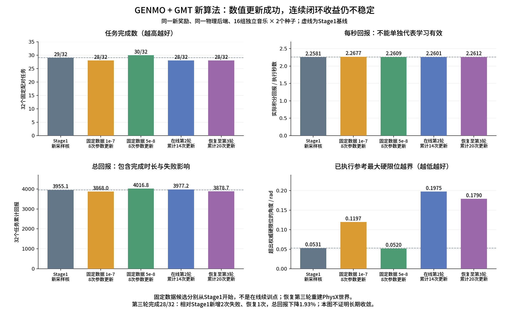

第二阶段非对称Critic与四步随机优化验收记录
=======================================

本报告说明2026年10月15日独立算法分支的实现、真实验收证据与剩余边界。
它不替代原P1训练报告，不把新奖励值与旧奖励直接比较，不把CPU或概率回放通过
解释为学习收益。每项数值注明实际工作量，并明确说明尚未证明的结论。

最终结论：奖励、因果数据流、非对称Critic、15+4+1采样、四步KL和真实恢复已完成
有限验收。Critic独立完整MC验证明显改善；Actor确实更新，但连续在线三轮后完成数
由29/32降到28/32，总回报下降1.93%，尚未形成稳定物理收益。没有启动新长期正式训练。

开发和运行边界
--------------

* GENMO：``feature/stage2-asymmetric-denoising``；GMT：``feature/stage2-tracking-history``。
  使用原本地工作树，未新建额外工作树。原训练代码保留在原分支。
* 新配置：``configs/closedloop/stage2_asymmetric_server2.yaml``。
  新Actor学习最多8个接受轮次，仅供有限验收；KL标定已绑定真实证据，非长期训练许可。
* 所有CPU、GPU和真实物理试验均在服务器2；服务器1只读核验。
  核验时服务器1为GENMO ``fe30a71``、GMT ``a2e7bf2``，均为原功能分支，
  P1恢复作业PID3746056及八个worker仍存在；20:32（北京时间）已发布第375轮完整checkpoint。
  本任务没有向服务器1同步、切分支、发信号、修改模型或抢占GPU。
* 统一证据根：
  ``/data1/user/liwei/GENMO_outputs/closedloop_stage10/stage2_asymmetric_20261015``。
  保留该目录用于用户要求的可复核验收；pytest临时目录逐次精确清理。
* 服务器2全部有限作业正常退出，GPU已释放。最终运行源码为GENMO ``6794aaf``、
  GMT ``7c3353b``；收尾只改报告、对照图、日志和YAML注释，不改变解析配置或源码身份。

实际算法和数据流
----------------

Stage1仍为s595000，冻结GMT为140500；GENMO实际输入/生成60帧、30Hz，每0.5秒重规划。
GMT为50Hz，PhysX为200Hz，每控制周期四个真实物理子步。连续物理episode、4秒共享
世界rollout、参考reserve/prepare/commit、未来10控制步保护和时间积分奖励保持。

奖励
~~~~

后端从实际任务RewardsCfg取得八项配置，并在真实控制时刻对照原mdp函数：

.. list-table:: GMT一致的tracking
   :header-rows: 1

   * - 项目
     - 原权重
     - std
   * - 全局Anchor位置/姿态
     - 0.5 / 0.5
     - 0.3 / 0.4
   * - Body相对位置/姿态
     - 1 / 1
     - 0.3 / 0.4
   * - Body全局线/角速度
     - 1 / 1
     - 1 / 3.14
   * - 两脚相对高度
     - 0.8
     - 0.07
   * - 原12腿关节位置
     - 0.5
     - 0.25

八项按原平方误差计算 ``exp(-error/std²)``，加权后除6.3；整体track_weight=2.5。
Body集合、相对对齐、具名脚和12腿关节与原MotionCommand一致。原函数对照保留严格
数值门槛，GENMO标量/GPU/列式三条路径使用同一八项定义。

music_weight=0且显式禁用音乐奖励；stable_weight=0。音乐条件、CFG、Stage1 BC、
配对动作活动门控、根高/姿态诊断和原物理失败条件均保留。

关节限位为 ``0.5 × (0.7 C_ref + 0.3 C_actual)``，参考是GMT当前消费的参考，实际是
真实关节。按运行时具名硬/软限位计算，越过硬限位后代价仍增长，不饱和为1。
记录硬/软最大超量、比例、关节名称、连续越界时长及两种独立代价；完整生成窗口的
可修改部分单独诊断，未执行后缀不重复计入50Hz奖励，不硬裁剪输出。

Critic
~~~~~~

仍为三个编码器：独立冻结Stage1音乐/前缀副本，加可训练历史跟踪GRU。Actor输入完全
不变。后端逐50Hz记录90维历史，GENMO在决策时检查其mask、时间戳和前48维与Actor
历史逐项一致；不能复制当前观测填50帧，也不能携带执行之后的状态或奖励。

GRU输入为90物理特征加相对时间，91→128，再接原128→1024投影。复制原48列与时间列，
新增42列严格零初始化；循环权重/bias/输出投影完整继承。历史学习率1e-5，时序融合和
Value Head为1e-4，维度256、2层、4头。Actor/Critic参数和存储独立，GMT无优化入口。

仅冻结音乐/前缀特征可缓存。历史输入可以缓存，历史GRU输出每次optimizer step重算。
当前/下一状态、PPO buffer、完整MC银行和诊断归档都保存相应时刻专用历史。
新完整MC预热从新Stage1行为采集，训练96任务、验证32任务，比较MC比例0/0.5/1；
实际50Hz积分奖励按 ``gamma_upper^(controls/25)`` 折扣，不二次乘dt，真实终止不自举。

扩散与KL
~~~~~~~~

* 0～14：独立冻结Stage1网络的随机先验。
* 15～18：可训练Actor的四个真实高斯转移，四步全部参与DPPO。
* 19：同一个冻结Stage1网络的确定性均值映射，无噪声、无Gaussian概率、无PPO项。
  contact来自该末步预测。

链保存21个状态、19个原始高斯mean/std/log-prob和采样创新；末步不伪造极小std。
当前候选标准差下限为前15步0.001、中间四步0.04/0.06/0.08/0.10、末步0；实际随机
std仍是基础DDIM std与显式下限的最大值。这些下限尚不能作为已定稿正式参数。

PPO使用自由有效坐标平均log-ratio代理，并保留真实joint诊断。最终安全KL无梯度
完整覆盖所有有效链×四步；冻结零值不进分母，确定性末步不参与Gaussian KL。
输出四步平均、最大单步均值、链/步平均坐标KL的P95，以及四步joint和的均值/P95/最大。
此P95不是把所有单坐标展开后的分位数，报告已明确口径。

冻结身份绑定参数、所有buffer、实际系数缓存、条件编码、时间映射、数值设置和核。
另对每卡至多16条链复用原创新重生成最终参考，报告真实输出变化；它是抽样参考诊断，
不替代全链四步KL，也不冒充物理执行。KL和这项额外诊断分别计时。

四步有限候选soft=0.00025，hard平均=0.0003、最大单步均值=0.0006、P95=0.0007。
这些值由下文同一真实rollout及32任务配对筛选，位于5e-8通过候选与1e-7物理退化候选
之间；相对于首轮候选门槛收紧，未加入冻结步零KL稀释分母。
标定发布入口为 ``python -m gem.closedloop.dppo.kl_calibration --help``，必须绑定真实
固定rollout报告、实际评估权重、完整32任务配对物理证据和选取理由。不能凭CPU JSON
测试、旧20步均值或概率复算通过启用Actor学习。

已经完成的验证
--------------

* GMT八项原函数对照CPU：20/20。
* GENMO扩展CPU组：初次103项中102通过，剩余旧3步测试夹具已迁移；随后该项及恢复、
  迭代停止、实际评估权重检查22/22通过。其他增量测试的完整输出在集中证据根。
* 服务器2真实s595000八卡math/policy/critic各8/8。batch 1/4/8/16/32/64/128、置换、
  有/无梯度重算最大误差1.82e-12；原概率门槛1e-4/1e-3/1e-8没有放宽。
  policy包含两次非空Adam与冻结先验不变；不能替代真实rollout上的DPPO+BC完整更新。
* GPU policy测试最高峰显存6,718,442,496 bytes；critic结构测试988,450,816 bytes。
  这些是指定测试的峰值，不是64环境正式训练峰值。
* 新单机器人部署标定：8卡×8有效测量，另每卡2次预热；中位0.258665秒、最大0.274805秒。
  加0.04秒保护并按50Hz向上取整，绑定0.32秒前缀预算。
  证据 ``deployment_pass2/deployment_calibration.json``，资产和行为核SHA写入配置。

第一份新奖励物理基线
--------------------

证据 ``baseline32_pass3/evaluation_baseline.json``，源码GENMO464da98/GMT7c3353b。
32任务为16首独立音乐×2seed；val的AIST只有2首独立音乐，显式配额为2/4/5/5，
没有拿同歌动作片段凑数，四来源总分仍等权。范围是最长完整配对样本，部分是原曲
裁剪片段；不声称都是未裁剪原始音频整曲。

.. list-table:: 完整配对样本真实物理结果
   :header-rows: 1

   * - 来源
     - 完成/任务
     - 物理失败
     - 每执行秒回报
   * - AIST++
     - 3/4
     - 1
     - 2.529014
   * - AIOZ-GDANCE
     - 8/8
     - 0
     - 2.530160
   * - FineDance
     - 8/10
     - 2
     - 2.135212
   * - Mine
     - 10/10
     - 0
     - 2.316667
   * - 合计
     - 29/32
     - 3
     - 2.258096

共87576控制步、350304真实物理子步、1751.52环境秒；无行政截断、无参考拒绝、
32条任务证据有效。评估主体墙钟558.85秒，含严格归档和不等长任务等待，不能当作
日常训练吞吐。前缀均18帧，60帧窗口剩42帧；末端音乐有效长度仍独立受mask限制。

实际活动度均值0.874671 rad/s，配对目标均值1.570726 rad/s，平均活动门控0.838041。
音乐同步性、真实加速度/jerk、完整参考运动质量作为零奖励诊断保存。

实际关节最大硬越界0.000901 rad；消费参考0.053092 rad；完整生成可修改部分0.199535 rad。
限位代价最大参考1.469838、实际1.052990，严重程度未饱和。
原总表曾漏传完整proposal诊断而显示generated_proposals=0，已修正聚合及新增回归。
本次完整生成最大值来自仍完整的逐episode生成诊断，原报告没有被改写。

三次失败均为yaw_anchor_ori：AIST样本gPO_sFM_cAll_d11_mPO0_ch08的seed42在43.88秒，
FineDance075的seed1729在103.60秒，FineDance138的seed1729在132.90秒。
这证明确定性末步没有消除长时朝向漂移和生成后缀越界；不能宣布新算法已经改善学习。
会话退出码0，源码保持不变，GMT实际权重与运行参数未变并正常关闭。

完整MC价值预热
--------------

证据 ``mc_preheat_pass1/sessions/7027bb87-f66e-447b-a60b-1b033abe4f98/mc_calibration/preheat.json``。
96训练任务和32独立验证任务全部收集；训练19次、验证4次真实物理失败照常作为完整
终止episode保留。验证3692个上层状态，真实回报均值53.2855，预测均值从-0.0514
升至52.4121。三候选从同一初始化开始，每个96 epoch，验证结果如下。

.. list-table:: 同一新奖励、新固定Stage1行为下的价值监督
   :header-rows: 1

   * - MC比例
     - 验证MSE
     - 验证EV
   * - 预热前
     - 3670.312
     - -0.000384
   * - 0，纯TD/GAE
     - 3126.940
     - 0.035736
   * - 0.5
     - 748.296
     - 0.690141
   * - 1，纯MC
     - 210.166
     - 0.746230

本次选纯MC，864次Critic更新；新增42维输入权重范数0.285204，确认历史GRU确实训练。
Actor更新次数0。完整采集及拟合墙钟1267.83秒，各比例拟合约35.3～35.7秒。
初始化文件 ``critic_init_complete_mc.pt`` 已严格导出并写入候选配置；它只初始化
同一固定Stage1行为下的Critic，不是旧训练恢复，不把旧MC长期作为更新Actor的无偏标签。
这些指标不能和旧奖励Critic的EV直接比较，也尚不证明Actor的物理学习收益。

完整MC的独立CPU复核覆盖128个episode、12077个上层状态。逐个50Hz积分奖励反向递推，
与保存MC标签的最大差7.68e-13；当前及下一状态90维历史的mask、50Hz时间戳、参考时刻、
Actor前48维与因果边界均通过。证据 ``complete_mc_independent_audit.json`` 绑定16份银行SHA。

真实rollout与四步更新
--------------------

``collect_pass1`` 使用新预热Critic采两轮连续共享世界窗口。第一轮3072条、第二轮4087条，
第二轮各rank为511/510/512/508/510/512/512/512条；不为凑齐固定条数增加物理执行。
世界控制准确0→200→400，每轮4秒。正常episode保留；歌曲结束后的单环境重置仍正常执行，
真实次数在 ``world_timing.completed_environment_resets``，不应把没有强制正常重置的
``normal_boundary_resets=0`` 误读为“没有任何终止重置”。

第一轮检查全部19个随机步骤，原联合概率差0，独立公式最大差9.09e-13。第二轮普通在线
概率检查只检查四个可训练步，冻结身份另查。实际旧链21×60×30，Critic历史50×90，
Actor历史50×48；八卡存储的标准差一致。前15步的0.001只是下限，实际DDIM标准差从
0.099659降至0.020638；索引15～18实际为0.04/0.06/0.08/0.10，末步没有高斯记录。
证据 ``actual_sampling_kernel_audit.json``，检查对象为每rank首条实际链，std不依赖状态。

同一第二轮4087条真实链、8次优化、512份BC，有限扫描LR1e-7/3e-7/1e-6。
首轮计算微批256，最终平均坐标KL为0.000507/0.001185/0.003364，后两项不通过原候选
门槛，未发布评估权重。另按最终选定微批64/KL128重新执行1e-7，证据
``actor_calibration_selected/report.json``：

* 四步平均坐标KL 0.000509702，最大单步均值0.000818962，P95 0.000994060。
* 四步joint链KL和的均值2.572978、P95 4.092173、最大69.985685；这些真实联合值保留。
* 超出PPO范围2.9117%，实际触发目标裁剪2.7587%，统一梯度裁剪系数为1。
* 同创新重生成128条最终参考，关节RMS变化均值0.001770rad，最大单关节变化0.021996rad，
  已承诺坐标全部不变；这是参考变化，不是物理执行。
* 首/末优化步PPO梯度范数0.6188/0.5934，已加权BC范数0.0657/0.1392，夹角余弦
  0.0163/0.0137。BC目标比例0.1由平滑控制器逼近，并非每一步实际比例恰好0.1。
* 完整Actor更新31.09秒，纯四步KL5.19秒，含额外最终参考诊断5.45秒。

同条件物理筛选与最终有限候选
--------------------------

``baseline32_matched`` 在最终源码上重做Stage1，32个任务的回报与首个新奖励基线
完全复现。更新Actor从同一4087条真实链开始，每个候选均8次DPPO+BC优化、512份BC。
随后使用相同的新奖励、物理配置、音乐、种子及参考时间合同独立执行32个完整配对样本。
原始报告保留，不通过重新算奖励更改结果。

.. list-table:: 配对物理结果（非旧P1奖励，也非全部独立test集）
   :header-rows: 1

   * - 模型
     - 完成/32
     - 真实失败
     - 每秒回报
     - 总回报
     - 实际执行秒数
   * - 新核Stage1
     - 29
     - 3
     - 2.258096
     - 3955.100
     - 1751.52
   * - LR 1e-7，8次优化
     - 28
     - 4
     - 2.267697
     - 3867.966
     - 1705.68
   * - LR 5e-8，8次优化
     - 30
     - 2
     - 2.260931
     - 4016.815
     - 1776.62

1e-7虽然通过首轮宽候选KL，却新增FineDance075、seed42的朝向跟踪失败：原本126.02秒
完成的任务在91.26秒结束。终止Anchor姿态误差约1.50rad，非yaw误差0.069rad，根高度
误差0.0045m；主要是朝向跟踪越过原失败条件。每秒奖励略升包含失败后缩短执行的影响，
不能解释为整体改善；该候选不发布为通过。

5e-8没有新增配对失败，FineDance075、seed1729从失败变为完成；另外两次原失败仍存在。
总回报提高1.56%，每秒回报提高0.13%，多执行25.10秒；活动度0.874671→0.880194rad/s，
活动门控0.838041→0.838675。分来源每秒回报：AIOZ2.530160→2.533540，
AIST2.529014→2.527773，FineDance2.135212→2.142067，Mine2.316667→2.316815。
这只支持进行有限在线验证，32任务及一次固定数据更新不足以证明长期收益。

关节边界也不是全面改善：实际硬限位最大超量0.000901→0.001389rad，但超界坐标比例
0.00008047→0.00006969；已消费参考最大超量0.053092→0.052006rad，全部可修改生成
参考最大超量0.199535→0.187492rad。未执行的参考仍有异常输出，不能因有冻结确定性
末步就声称完全平滑或关节合法。

5e-8四步平均KL0.000213220，最大单步均值0.000358413，P95 0.000452675；8次更新前
soft统计最大0.000175289。四步joint链和均值1.076332、P95 1.840328、最大24.503013，
有效目标裁剪比例0.8503%。选定soft/hard门槛与这些实测值保留有限余量，并排除1e-7
已出现物理退化的分布。3e-8也完成数值扫描，但未做物理评估，不作为已验收候选。
噪声仍为0.04/0.06/0.08/0.10；此次标定验证该实际随机核的有限可用性，没有证明它是
所有噪声日程中的最优解。

证据为 ``actor_calibration_conservative/report.json``、
``paired_stage1_actor_selected.json`` 和 ``paired_stage1_actor_conservative.json``。
5e-8实际评估权重SHA为
``3a7045cd6020b1ebdfa40a87ff2241eb2a23b11b10fb2873cee31526958effdc``。
独立门禁以收紧后的门槛重新核验所有实测字段，并发布
``four_step_kl_calibration.json``，SHA为
``fdacb39b6f79bc4588c06ba6f28916ea5d2551d58837149e621fe25b0986bc71``。
配置/证据门禁/非空Adam与累计轮数恢复等36项CPU集成检查在服务器2全部通过。

真实GPU计算对照
---------------

``compute_pass1`` 先建立共同非空Adam，再比较同一完整工作量。每候选一个诊断轮、
一个预热轮及一个正式计时样本，因此下列值只用于有限筛选，不是多日稳定吞吐结论。

.. list-table:: stable_tf32x3同核的实际微批对照
   :header-rows: 1

   * - 对象
     - 微批
     - 完整工作量秒数
     - 峰值已分配显存
   * - Actor，8次PPO+BC更新
     - 64
     - 29.50
     - 14.83 GB
   * - Actor，8次PPO+BC更新
     - 256
     - 32.81
     - 约43.65 GB
   * - 全部有效链×4步KL，含抽样最终参考诊断
     - 128
     - 5.12
     - 见原始report
   * - 全部有效链×4步KL，含抽样最终参考诊断
     - 512
     - 5.38
     - 见原始report

256微批梯度及参数通过现有对照容差，Adam有一个张量最大差1.89e-7，末端输出最大差
3.58e-6，未满足既有更严格门槛。它也没有速度优势，因此保留64/128；没有将微小
跨微批舍入差异解释为物理失败，也没有切换数值核。本实现仍是实际微批GEMM，不是
旧的固定64网络行Python切块路径。

独立profiler单步插桩墙钟8.30秒，GPU计算核区间并集2.94秒、NCCL0.13秒、主机同步API
0.99秒。插桩有扰动，API阻塞并非全部CPU空闲时间，不能把这些值直接当日常GPU利用率。
第二个连续rollout采集墙钟最大56.66秒，连同价值目标/预算58.09秒；第一轮含初始化为
74.88秒。以下另外报告实际在线整轮，不能把离线Actor计时当正式训练吞吐。

真实在线更新与恢复
------------------

``online_finite`` 从新Stage1及本次MC预热开始，两轮后正常关闭，再使用同一配置的
``--resume latest --stop-after-iteration 3`` 恢复。初次会话
``1e30abe2-9207-4cf2-97da-b6c9784265dd`` 正常退出0，源码、冻结GMT及所有ACK边界检查
通过；恢复会话为 ``85cbbb58-d92a-4b63-905c-291e3a7898ec``。

.. list-table:: 实际八卡在线轮次（评估和checkpoint额外开销另计）
   :header-rows: 1

   * - 累计轮次
     - 有效转移
     - Actor优化步
     - 采集秒数
     - Actor秒数
     - Critic秒数
     - 纯四步KL秒数
     - 整轮秒数
   * - 1
     - 3072
     - 6
     - 76.16
     - 25.83
     - 4.16
     - 3.97
     - 130.64
   * - 2
     - 4087
     - 8
     - 60.36
     - 35.62
     - 5.42
     - 9.54
     - 119.03
   * - 3，恢复后
     - 3072
     - 6
     - 75.47
     - 25.73
     - 3.98
     - 3.77
     - 111.47

三轮BC均为512份，四来源均参与；没有soft提前停止或hard回滚。四步平均KL分别
0.000248748/0.000114616/0.000045071，P95分别0.000558698/0.000248573/0.000100839。
实际检查12288/16348/12288个随机转移；PPO更新与KL期间物理时钟均保持不变。
第二轮单卡PyTorch峰值已分配15.70GB、reserved16.75GB，不包含PhysX外部分配。
第二轮有效上层转移吞吐34.34条/秒。这里只有一轮常规连续窗口，不能声称多日稳定
吞吐，也不能直接用旧P1的114秒/147秒宣称提速；奖励、历史和行为核已经改变。

前两轮各卡世界控制0→200→400，第二轮使用行为版本1、每卡508～512条变长转移，
总共只有6个音乐正常结束环境单独重置，正常机器人没有整批重置。恢复后按合同
重新建立PhysX，第三轮使用版本2、世界0→200，512个新episode重新初始化。
Actor更新计数14→20、Critic计数1088→1184，累计轮次2→3，没有重新预热或从零训练。
保存与恢复均保留两个Adam、BC控制器、各rank RNG及任务采样器；不声称PhysX逐帧恢复。

Critic第一批当前自举目标MSE22.7447→8.7894；下一批拟合前MSE16.1785，拟合后3.8180。
恢复后新批拟合前11.6428，拟合后3.8070。这些GAE/TD诊断含自身bootstrap，不等于
独立完整MC的真实价值误差，不能用接近1的在线EV替代前述完整MC验收。

在线两轮后的效果没有稳定保持
~~~~~~~~~~~~~~~~~~~~~~~~~~

``paired_stage1_online2.json`` 显示29→28/32完成、新增FineDance138 seed42失败。
该任务159.20秒完成变为154.02秒yaw终止；最后控制时刻Anchor姿态平方误差2.2441，
非yaw误差0.0370rad、根高误差0.00475m，失败不是取消安全终止所致。
原FineDance138 seed1729则132.90→149.58秒才失败；总回报3955.100→3977.168、
每秒回报2.258096→2.260063的上涨包含这种执行时长差异，不能覆盖新增失败这一事实。

活动度0.874671→0.881046rad/s，没有静止逃避跟踪的迹象；但已消费参考最大硬越界
0.053092→0.197469rad，实际最大越界0.000901→0.001373rad。完整生成后缀最大越界
0.199535→0.197469rad并没有明显变化，说明仅看完整窗口最大值也可能漏掉“异常部分
实际被消费”的变化。两种边界和全部生成后缀必须分别看，不能以硬裁剪掩盖它们。

单次固定数据候选5e-8通过物理筛选，连续在线两轮却出现新增失败，说明单轮KL约束
与小步参考变化不能保证长期闭环轨迹改善。当前实现具备可执行的训练与恢复通路，
但尚不能认定算法效果稳定优于新核Stage1；配置仅供有限验收，没有定稿为长期正式参数。

第三轮最终物理对照
~~~~~~~~~~~~~~~~~~

``paired_stage1_online3.json`` 已完成。与Stage1使用相同新奖励、物理后端、32任务及
种子；完成28/32，相对Stage1新增两次失败、恢复一次。FineDance075 seed42由126.02秒
完成变为91.26秒失败，FineDance138 seed42由159.20秒完成变为144.88秒失败；
FineDance075 seed1729由103.60秒失败变为126.02秒完成。

.. list-table:: 同条件完整可用配对任务对照
   :header-rows: 1

   * - 模型
     - 完成数
     - 每秒回报
     - 总回报
     - 实际执行秒数
   * - Stage1，新15+4+1采样核
     - 29/32
     - 2.258096
     - 3955.100
     - 1751.52
   * - 固定数据1e-7，8次更新
     - 28/32
     - 2.267697
     - 3867.966
     - 1705.68
   * - 固定数据5e-8，8次更新
     - 30/32
     - 2.260931
     - 4016.815
     - 1776.62
   * - 在线两轮，累计14次更新
     - 28/32
     - 2.260063
     - 3977.168
     - 1759.76
   * - 恢复至三轮，累计20次更新
     - 28/32
     - 2.261213
     - 3878.749
     - 1715.34

固定数据候选分别从Stage1开始，不能视为在线训练的前后检查点。第三轮总回报下降
1.93%，少执行36.18秒，每秒回报却略升，再次说明只看奖励率会漏掉任务失败。
活动度0.874567rad/s、活动门控0.839184，与基线0.874671/0.838041接近，没有明显静止
逃避的迹象。实际硬越界最大值降至0.000428rad，但已消费参考仍达0.179029rad，
明显高于基线0.053092rad；生成后缀最大值0.186897rad。实际、已消费参考、完整生成
后缀的变化方向不同，不应合并成一个“关节安全改善”的结论。

图中左上看任务是否完成，右上看每秒奖励，左下看全任务累计收益，右下看GMT实际
消费的参考有无越界。所有纵轴从0开始；原始绘图数值及四份配对报告SHA保存在
``stage2_asymmetric_comparison_values.json``。配对报告中的status=passed仅表示证据
完整且条件一致，不代表模型学习效果通过。

真实checkpoint审计与交付权重
~~~~~~~~~~~~~~~~~~~~~~~~~~~

``finite_resume_audit.json`` 逐文件验证真实checkpoint SHA与完整训练身份，两轮恢复
到第三轮通过；两个会话均退出0，源码未变，冻结GMT关闭检查通过。

* Actor的320份非空Adam状态全部从14步延续到20步，310个参数张量实际发生变化。
* Critic的48份非空Adam状态全部从1088步延续到1184步。历史GRU学习率1e-5、
  时序网络/Value Head为1e-4；6个历史模块张量改变，冻结音乐/前缀及buffer逐值不变。
* 八rank的BC计数均14→20，保存Python/NumPy/PyTorch/CUDA及Actor/Critic独立RNG。
  CPU回归另外检查随机状态恢复路径；不把状态存在宣称为PhysX逐位重演。
* 累计训练控制步418001→520401，物理步1672372→2081972，资源预算没有重置。
  恢复后重建PhysX和episode，与正常rollout边界保留世界是不同合同。

最终评估后的完整实际权重位于证据根下：

``online_finite/checkpoints/stage10_r000003_a000020_01792067353462450234_1368e5291e47_evaluated_final_000003.pt``

文件SHA为
``69f66ea2b1f844134cf3ab06b1ac7bfbb374cfa656a4c14cec07a8c81a74f6ea``，
Actor指纹为
``903d82fe648e795b5333150d2f6a5f8c755b0796335d25fbed1f5c93924371dc``。
审计使用其此前同轮controlled_end完整checkpoint；末次评估没有继续更新参数。
全部权重和原始物理证据保留在服务器2，不加入Git。

普通采集目录初次两轮共387698字节/32文件、恢复一轮175742字节/16文件，不长期保存
每轮完整去噪链。严格验收包含完整控制证据、实际权重及大体量评估JSON，属于本次
明确要求保留的交付证据，与日常训练归档区分。

剩余问题与下一步建议
------------------

当前功能/数值/恢复验收已完成，不能替代稳定学习收益证明。完整MC预热说明新Critic
能拟合真实回报，但没有同新奖励下旧Critic的架构消融，不能把改善完全归因于特权历史。
一次固定数据候选的正面结果未在连续在线更新中稳定保持；三轮也不足以判断长期收敛。
更广泛独立音乐/种子、长期曲线和不同四步噪声日程比较仍未完成。

优先使用已经保留的FineDance075/138失败轨迹，定位朝向误差增长前的参考变化、
被消费关节越界及对应优势/价值误差；这两个现象是已观察到的问题，还不是已经证明
的单一因果机制。随后在同一新奖励下做有针对性的有限配对验证，再决定参数或算法
调整。不要直接扩大训练、放松KL、按每秒奖励选模型，或用逐帧硬裁剪隐藏异常参考。
当前配置保留为可复现的有限候选，不定稿为长期正式训练参数，也不自动追加训练。

旧P1的rollout、Critic和优化器不进入这条新恢复路径。checkpoint恢复仍重建PhysX世界，
从新物理episode采样，不恢复虚构PhysX中间状态。日常rollout在更新完成后释放，完整
物理证据仅在严格验收、周期诊断和异常保留。
