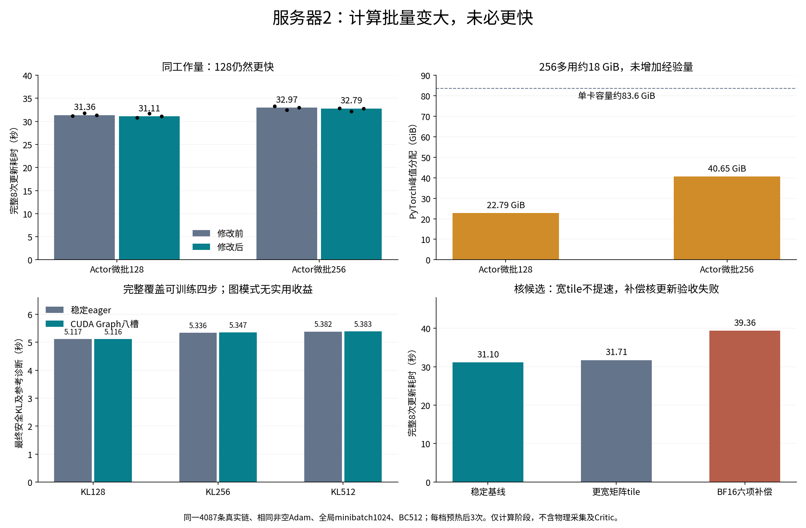
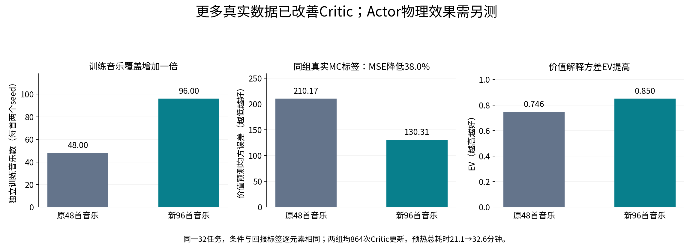

第二阶段大显存容量与执行优化验收（服务器2）
================================================

本轮范围与身份
--------------

使用 GENMO ``feature/stage2-asymmetric-denoising``、GMT
``feature/stage2-tracking-history``。服务器1原训练不修改。计算和物理实验全部在
服务器2的八张 RTX 6000D 进行；每卡 nvidia-smi 总显存 85651 MiB。实验根目录：

::

  /data1/user/liwei/GENMO_outputs/closedloop_stage10/stage2_capacity_20261015

保留 s595000、GMT140500、新八项跟踪奖励、90维非对称历史、60帧、15冻结＋4随机
可训练＋1冻结确定性末步。采样完整20步，最终安全检查覆盖全部有效链的四个
可训练步骤。物理50/200Hz、连续episode、前缀保护及预算不变。没有启动长期训练。

本文件随有限验收补充；未完成项目不得解释为已通过或正式推荐。

已完成实现
----------

* ``joint_limits.py``、``vector_generation.py``：生成参考限位在设备端批量FP64归约，
  与独立NumPy公式逐字段对照；诊断随必需参考输出合并D2H，去掉逐环境free mask同步。
  参考时间轴仍消费CPU数据，本轮没有宣称整条参考通路全留GPU。
* ``tracking_context.py``：90维历史和时间戳整批上传、一次核验，随后按环境提供视图。
  原整数tick在CPU转换FP64秒，保留严格同时间戳、过去50Hz、未来信息拒绝检查。
* ``updater.py``：合并当步统计SUM，BC来源/逐步诊断/Critic loss阶段末汇总；必要soft KL、
  非有限值、BC梯度比例、裁剪及空rank通信仍保留。函数返回时原完整日志字段已补齐。
* ``gradient_merge.py``：使用本次独立通信bucket视图，消除逐参数clone，不跨步复用活跃梯度。
* ``cuda_graph_forward.py``：默认关闭的有界纯推理图候选，初测两个、后测最多八个真实形状，第三次同形状
  调用才捕获，梯度/BC继续eager，随机采样在图外。参数原位更新可见，存储替换重建；
  保持None、输出别名和独立输出存储。不填充有效样本，不自动改变数值核。
* ``prepare_stage2_capacity_cases.py``：生成独立完整实验配置和manifest，拒绝覆盖；只生成，
  不自动启动训练。新源码下重新预热Critic，不能修改旧artifact的SHA来绕过身份校验。

CPU与小规模GPU回归
-----------------

第一批69项通过，包含独立限位、非空Adam、Gloo真实归约、四步PPO顺序、因果历史、
Critic缓存及CUDA Graph。补充批量历史/真实输出结构后6项通过；单独图/Adam用例2项通过。
测试选择有重叠，不把69＋6＋2当作77个互不重复用例。首次旧夹具失败和临时副本缺少tools
的导入错误均保留原日志并更正记录；没有修改生产容差或添加旧算法兼容来使测试通过。
临时源码、pytest缓存及Git传输bundle在使用后精确删除。
进入物理阶段前重新执行整套选择用例：71项通过，10.83秒；有限容量配置的4/4/2/2轮、
40/40/36/36次Actor优化尝试上限及硬KL失败退出也通过配置验证。

固定真实数据的计算批量扫描
--------------------------

输入为新算法既有真实Isaac采集的iteration000002：4087条有效链。所有候选同一份old统计、
相同非空Adam共同起点、全局minibatch1024、两epoch、8次optimizer更新、32696次内部转移
访问、BC总量512。每档先做完整梯度/参数/Adam/输出检查和预热，再计时3次；纯离线副本
关闭soft停止只为保持同工作量，仍报告原hard KL，不发布训练权重。
Actor/KL微批的单位是去噪转移；合批CFG使实际网络batch翻倍，不是物理环境数或全局
optimizer链minibatch。128档对应的主要Transformer矩阵行数为128×2×60=15360。

初次服务器2拉取因GitHub DNS失败，实际旧提交2ae49bc的扫描单列为``compute_stable``。
新版9ecda38先推送GitHub，再用核验过的增量Git bundle执行``pull --ff-only``；扫描期间
没有热更新源码。新版结果为``compute_optimized``，两次来源明确区分。

.. list-table:: Actor完整更新耗时（秒），括号内为三次正式计时
   :header-rows: 1

   * - 微批
     - 修改前中位数
     - 修改后中位数
     - 新版PyTorch峰值GiB
   * - 128
     - 31.364（31.155 / 31.768 / 31.364）
     - 31.112（30.782 / 31.683 / 31.112）
     - 22.79
   * - 256
     - 32.973（33.322 / 32.458 / 32.973）
     - 32.794（32.837 / 32.149 / 32.794）
     - 40.65

新版完整最终KL＋参考变化诊断，中位数分别为128：5.117秒、256：5.336秒、512：5.382秒。
这些小幅差异不足以声称更新阶段显著提速。相同经验量下256消耗更多显存且较慢；增大
计算微批没有增加数据利用次数，也没有自动增加统计信息。

256相对128的完整更新参数与Adam通过原检查，但末端归一化输出最大差约4.53e-6，未通过
工具原1e-7输出对照门槛。保留这一失败，不把它改写为通过；它与零更新概率一致性是
不同检查。后续物理规模测试会分别报告真实安全KL和物理质量。

新版独立profiler的一个插桩优化步墙钟8.613秒，GPU计算核区间并集3.113秒，NCCL0.130秒，
主机同步API区间1.109秒，共123074个kernel事件。``multiply``矩阵核累计1.703秒，另一条
SIMT权重梯度GEMM累计0.642秒。区间可能重叠；profiler有扰动，不能把这些数直接相加，
也不能用插桩墙钟推断普通训练的纯CPU空闲比例。轨迹SHA及原trace与report一并保存。

数值执行候选
------------

CUDA Graph真实s595000八卡自身概率验证已通过：batch1/4/8/16/32/64/128、样本置换、尾批、
有/无梯度重算保持原门槛，误差约1e-12；实际Transformer长度60、预训练最大长度120，
非空Adam和冻结部分检查通过。每个rank记录捕获/重放/淘汰次数，表明实际执行了图。
此结果不代替完整真实rollout梯度对照、部署延迟重新标定或物理效果。

同一固定rollout完整更新三次计时中位数：stable31.102秒、wide tile31.713秒、
BF16六项补偿权重梯度39.365秒、CUDA Graph31.332秒。wide tile通过梯度/参数/Adam/输出
对照但未加速；六项补偿通过梯度容差但参数/Adam/输出未通过且更慢，不采用。

两个图缓冲的CUDA Graph最终KL中位数为128：7.759秒、256：9.938秒、512：13.865秒，
明显慢于eager。捕获/淘汰计数定位到整批、尾批、参考变化诊断形状竞争两个缓存槽，
反复捕获抵消收益。显式候选上限扩为8后重新检查；通过新增``--kl-only``在同一非空Adam
起点只重测KL，避免重复已验收且未改变的eager梯度更新。容量物理实验仍固定稳定eager核。

八槽图的最终稳态复测每档先预热3轮再计时3轮，正式计时内捕获数全部为0、无淘汰。
128档为5.119/5.115/5.116秒，256档为5.347/5.339/5.353秒，512档为5.384/5.383/5.381秒。
与eager没有实用差距，因此本轮不启用CUDA Graph。原始冷捕获结果继续保留。

真实profiler记录的主要权重梯度矩阵包括1024×15360乘15360×1024、4096×15360乘
15360×1024，以及1024×15360乘15360×4096；注意力批量矩阵的真实序列维为60。
``matrix_shapes.json``保存调用次数和CPU发起时间；CPU发起时间不能冒充对应GPU核耗时。

容量实验设计与完成情况
----------------------

已生成新完整MC配置，并核验96首互不重复的音乐组及音频（四来源各24首），两训练种子
共192完整episode；独立验证仍为原32任务。音乐数是原来48首的两倍，不靠增加同歌片段凑数。
完整MC已通过，下列四组学习对照正在顺序执行；尚不宣称Actor物理质量提高。

128环境/卡连续采集已正常完成两窗：世界控制时钟0→200→400，0物理失败、0普通边界
重置，源代码和冻结GMT未变。首窗有效6144链（初始化已占用物理工作），采集140.495秒；
第二窗8178链、108.938秒，即75.07链/秒。每窗实际分配819200个物理子步，分别153600、
204298个有效训练控制步，所有初始化和尾部工作保留在资源账本中。概率重算最大差
4.55e-13。采样阶段nvidia-smi实测单卡最高12396MiB，此数不代表反向传播峰值。

Critic初始化导出身份补齐实际MC/TD监督及TD片段长度。纯完整MC标签不依赖PPO窗口，
允许4/8秒对照共享同一Stage1行为的初始化；选中含TD标签时要求匹配片段长度，否则
修改Critic/Adam前拒绝。新增身份不接受缺少这项记录的旧artifact；18项服务器2CPU
回归通过。该校验辅助模块不改变采样/训练行为，运行中的MC源代码保持不变，待结束
后才同步；导出仍严格核对产生checkpoint的全部实际关键行为源码，不补签新指纹。

完整MC扩数据的实测结果
---------------------

本次完整MC会话``6a7a42c6-0f58-40c5-9506-dd197bae4ce7``在6a230d2源码上正常结束，
退出0、源码未变、Actor未更新。192个训练episode产生17715个状态、440901个真实控制步；
32个独立验证episode产生3692个状态、91997个真实控制步。完整episode包含歌曲结束或
真实物理失败，不把行政截断伪装为完整MC。

独立审计16个银行、224个episode和21407个状态，从每个50Hz积分奖励反向递推，事件罚分
只加入末控制步，不再乘dt。最大标签差8.38e-13；当前及next历史因果合同通过，train/val
音乐组和音频SHA无交集。验证集与原预热的32任务条件和回报标签逐元素相同。

.. list-table:: 同一独立MC验证集的价值预测
   :header-rows: 1

   * - 预热方案
     - 独立训练音乐
     - 训练状态
     - 选中Critic更新次数
     - 验证MSE
     - 验证EV
     - 预热总墙钟
   * - 原方案
     - 48
     - 8385
     - 864
     - 210.166
     - 0.74623
     - 1267.83秒
   * - 本次扩数据
     - 96
     - 17715
     - 864
     - 130.315
     - 0.84961
     - 1957.64秒

同验证标签下MSE下降38.0%，是本轮已观察到的价值预测改善。两组优化次数相同，但本次
Critic全局batch从1024增到2048、真实训练数据更多；不能把效果单独归因于显存占用。
本次平均预测50.791，平均真实MC为53.286，仍有约2.494的低估偏差。新预热结果不证明
Actor训练后更稳定，也不是独立测试集上的长期收敛证明。

新候选MC比例0/0.5/1的验证MSE分别3177.940/710.173/130.315，EV分别
0.04561/0.72799/0.84961；各864步，选中纯MC。因此4/8秒对照可以严格共享本次初始化。
源checkpoint SHA为``349c72db1baa5ba8ea2979320940664a156020b8fd36b537fca0f36b072ebfc5``；
等待进程和GPU工作全部退出后才将辅助校验同步到1c543e6并导出，全部关键行为源码核验通过。
新artifact为证据根``critic_init_complete_mc.pt``，SHA
``e507e974719802afea3c563ee2a07da8912bd753cda98c6198e628b8d30e43a1``。

有限容量学习设计
----------------

.. list-table:: 四组有限容量实验
   :header-rows: 1

   * - 每卡环境
     - 世界窗口
     - Actor微批
     - 全局PPO链minibatch
     - BC/rollout
     - 有限轮数
   * - 128
     - 4秒
     - 128
     - 2048
     - 1024
     - 4
   * - 128
     - 4秒
     - 256
     - 2048
     - 1024
     - 4
   * - 128
     - 8秒
     - 128
     - 2048
     - 2048
     - 2
   * - 128
     - 8秒
     - 256
     - 2048
     - 2048
     - 2

四组均generation_batch128、Critic全局batch2048/32epoch、PPO两epoch、Actor学习率5e-8，
各组名义16秒世界时间；实际GMT控制数、初始化/重置开销及有效链数必须另行对账。
4/8秒的主要差别是同一个行为版本连续执行的时间、GAE片段长度与策略发布频率。
各组独立运行身份，从同一新MC成果初始化；不继承旧P1或本次其他候选的Actor/Adam。
有限组遇到硬KL拒绝时整轮回滚并退出，不通过额外rollout凑接受轮数；同时收紧每组
实际停止上限和Actor优化尝试预算。soft KL及原全部物理、资源保护保持。

第一组结果：128环境、4秒、Actor微批128
--------------------------------------

已正常完成四轮及更新前/后的完整物理对照，源代码保持1c543e6。真实链数为
6144/8178/7859/8071，共30252；Actor共30次更新，Critic共480次更新，BC4096。
world连续0→200→400→600→800，所有rank恰好16秒，共分配3276800物理子步；
816857个实际GMT控制、753957个有效奖励控制，没有额外配额对齐推进。
普通rollout边界重置正常环境为0，实际episode初始化/结束后的reset事件1263，
训练期间真实物理失败1次、预热失败0次，二者不能与普通边界重置混为一谈。

首轮256.280秒含启动核验；后三轮196.399/193.881/195.408秒，中位195.408秒，
合计稳态吞吐41.16条有效转移/秒。整卡nvidia-smi峰值38.06GiB；反向期间八卡
利用率达到100%、约400W。四轮KL均通过，均值0.00018924/0.00012784/0.00006512/
0.00006277，无soft停止和硬回滚。该事实不保证物理质量改善。

物理对照仍完成29/32：FineDance075 seed1729恢复，FineDance138 seed42新增失败。
总回报3955.100→3999.898（+1.13%），每秒2.258096→2.266848（+0.39%），活动度
0.874671→0.875242rad/s。分来源等权回报变化+1.029，按音乐簇分层bootstrap的95%
区间约[-1.317,4.126]，跨0；不能宣布稳健收益。

实际硬越界最大量0.000901→0.001245rad、软越界最大量0.017901→0.070997rad；
已消费参考硬越界最大量0.053092→0.052444rad，但完整生成后缀硬越界最大量
0.199535→0.226283rad。不同口径有升有降，不能只挑已执行部分的一个改善指标。
``paired_env128_world4_actor128.json``已复核权威journal的SHA、完整控制序列与四子步；
正式音乐簇bootstrap区间与上面轻量汇总一致。``normal_boundary_resets=0``是采集器
声明的合同字段，不能单独当成动态重置证据；实际reset事件、世界时钟及连续状态检查
分别保留。8秒两档尚在顺序执行，最终窗口选择留待完整矩阵完成。

第二组结果：128环境、4秒、Actor微批256
--------------------------------------

正常完成四轮，实际链数同为30252、Actor30步、Critic480步、BC4096，分配物理子步
仍3276800。实际GMT控制816853、有效奖励控制753953，与128档因真实执行差异略有不同；
不以相同链数伪称逐控制轨迹相等。四轮均无soft停止或硬KL回滚。

首轮258.542秒，后三轮196.174/192.547/201.630秒，中位196.174秒，稳态40.84链/秒；
四轮合计848.894秒。PyTorch峰值42.38GiB，整卡nvidia-smi峰值56.10GiB，后者还包含
缓存、Isaac等分配。相较128档更多显存并未带来吞吐收益。

物理完成29→28，新增FineDance138 seed42失败。总回报3955.100→3949.101（-0.15%），
每秒回报2.258096→2.255212，活动度0.874475rad/s。分来源等权配对差-0.285858，
95%音乐簇区间[-3.004371,2.184568]；权威执行记录核验通过，收益未成立。实际/已消费/
完整生成后缀的最大硬越界分别0.000619/0.052026/0.228913rad，后缀越界没有改善。
两档仅一个训练种子和有限轮数，不能把完成数差异当作微批大小的普遍学习规律。

已有64环境配置的稳态单轮4087链/119.028秒，即34.34链/秒；本次128档为41.16链/秒。
这只是系统配置的历史上下文比较：两次Critic初始化、全局批量与源码都有变化，且旧组
仅一个稳态样本，不能把约20%的差距全部归因于本批代码优化。严格同工作量的计算比较
仍以上文4087固定链、共同非空Adam的三次扫描为准。
