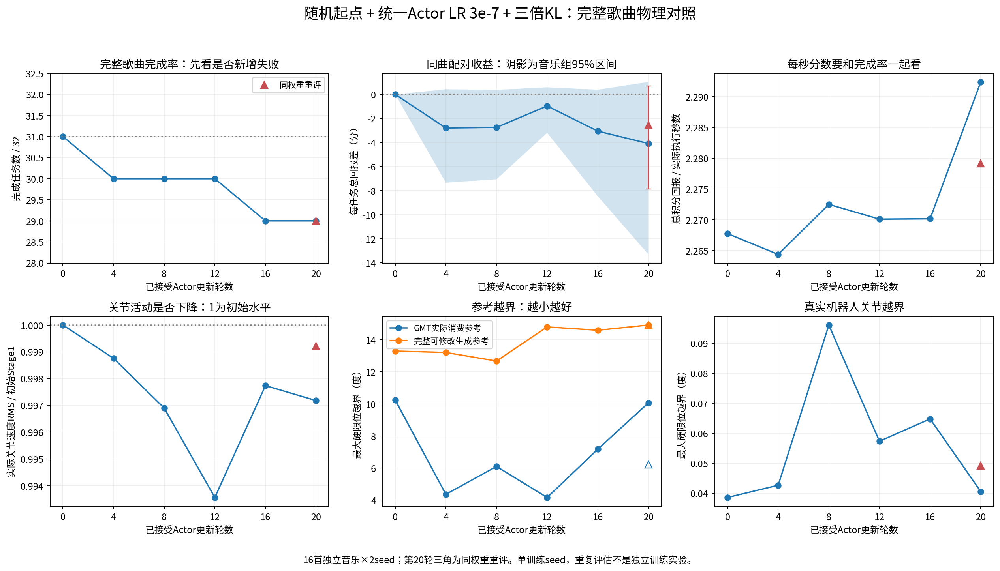
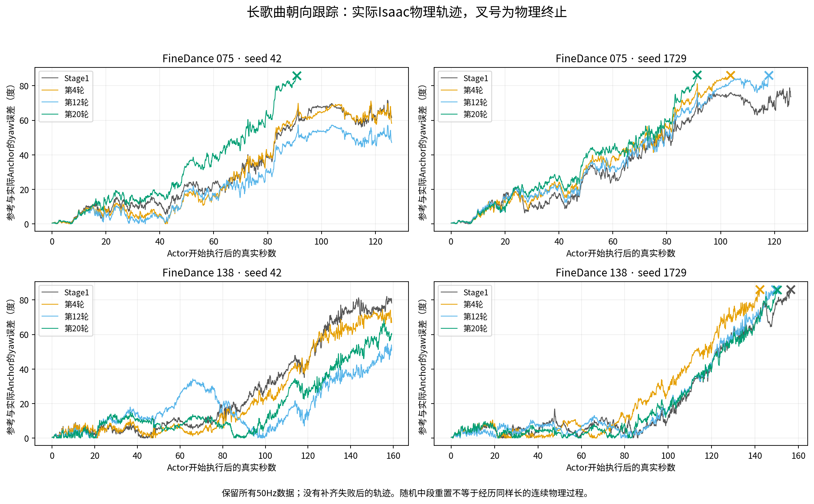
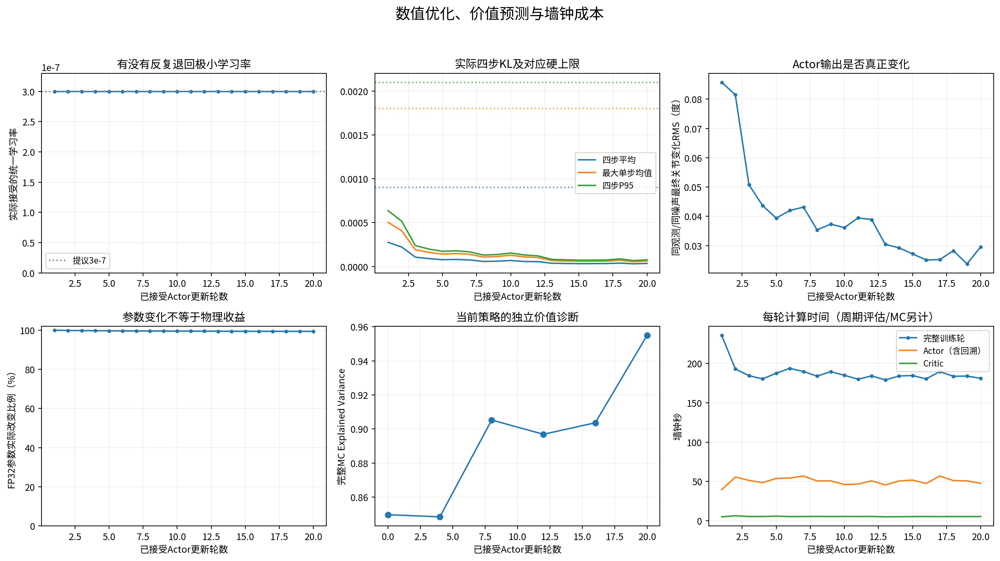
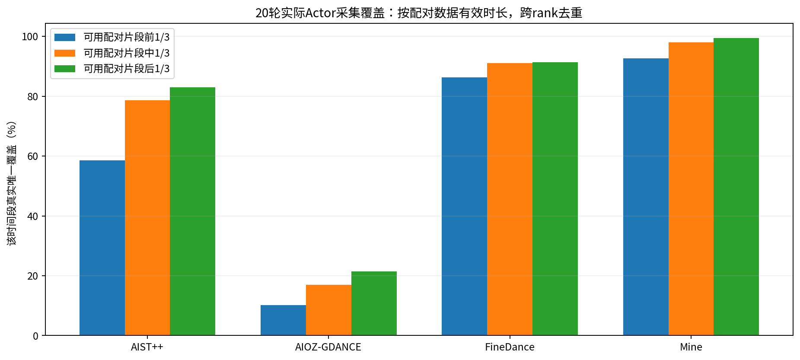

随机音乐起点与统一学习率二十轮实验
====================================

本报告对应服务器2的单次有限实验。移植对象是原训练分支当日完成的随机音乐位置、
配对运动初始化、1秒真实GMT预热和精简TensorBoard；保留实验分支的非对称Critic、
GMT八项Tracking及15+4+1扩散结构。2026-10-16已完成20次接受更新、7次固定32任务
物理评估、5次当前策略完整MC诊断及CPU全证据审计，训练正常退出。

结论：移植功能与真实闭环执行通过；本次训练没有证明完整歌曲性能提升。初始完成31/32，
第20轮及同权重复评估均29/32；新增失败集中于FineDance075的累计yaw误差。
Actor参数与输出确实变化，没有反复回溯至小学习率；每秒回报上升主要受提前失败、
少执行后半段影响。保留本次3e-7为后续实验参考，不据此启动几百轮正式训练。
服务器1、旧训练源码、模型和运行目录均未修改。

运行身份
--------

* GENMO开发分支：``feature/stage2-asymmetric-denoising``。
* GMT开发分支：``feature/stage2-tracking-history``。
* 实际训练源码：GENMO ``806ed69b06a66e2bd2dc7c6341b70b11df1e760f``，
  GMT ``3c05061c6ab09664c7f95fa50fa66c5a797a0a2c``。
* 配置：``configs/closedloop/stage2_random20_server2.yaml``；运行副本SHA256：
  ``9920e695a90beeb28896e50109b10ddbe46925724d9c43e960217d24fe69bff5``。
* 服务器2根目录：
  ``/data1/user/liwei/GENMO_outputs/closedloop_stage10/stage2_random20_20261016``。
* 实际训练子目录：``train``；session为
  ``06462853-75c9-41d1-aadc-0b96aa4a7455``。
* 训练进程启动时间：2026-10-16 18:15:33，北京时间；由Linux进程启动tick与boot时间
  读取，保存于``timing_observation.json``。预检不计入该进程时长，MC预热和后续评估计入。
* 退出时间：2026-10-16 21:54:05.856，北京时间；完整训练进程13112.45秒，约3小时38分32秒。
  ``exit_code.txt=0``，summary确认源码未变、GMT冻结检查和执行ACK关闭通过。
  ``completion_observation.json``确认本次训练进程及GPU进程已退出。CPU审计随后完成，
  ``analysis_exit_code.txt=0``且``analysis/review.json.status=completed``。
* 最终checkpoint：``train/latest.json``指向第20轮实际完整权重，iteration与actor_updates均20；
  文件名``stage10_r000020_a000020_01792158735553802784_932a7d5c93d7_evaluated_final_000020.pt``，
  SHA256为``6c7c5b003824ce0b4b99d63d4421c4345ddbd82633c1e0917cf3ee52ddf3f727``。

运行中的源码保持不动。后续新增的只读分析、绘图与本报告另行提交，不能把这些提交的
HEAD误写为已运行模型的源码身份。旧P1、旧学习率扫描和旧Critic成果均未覆盖或冒充恢复。

这次移植了什么
--------------

原分支来源为GENMO ``90456a4``、``6c8ecc0``、``cd93dc1``与GMT ``5480ce1``。
本次按实验分支的数据合同集成，没有用原分支的旧奖励、旧Critic或旧扩散核替换实验实现。

音乐与真实状态初始化
~~~~~~~~~~~~~~~~~~~~

``time_sampling.py``把各来源合法音乐起点划成1秒时间箱，使用共同种子打乱后分配给不同
rank。一个rank内的128个环境共用无放回游标，避免每个环境各自打乱却重复选择相同起点。
时间箱走完后才在本rank重排；箱内按30Hz帧随机选择。分片、RNG、游标、轮数和采样次数
均进入checkpoint身份。跨rank分片数或旧采样合同不同不能等价恢复。

新任务保留20%站立开头，80%采用配对运动随机起点。``motion_initialization.py``与GMT
``motion_reset.py``校验示范来源与关节名称，初始化对应运动状态，再执行1秒真实GMT控制。
预热产生的是机器人实际状态；不能把示范轨迹直接填作Actor历史或90维Critic历史。
reset的根/关节位置和速度有实际回读检查，初始化软限位处理单独记录，不裁剪GENMO输出
掩盖越界。GMT每次控制仍执行四个真实200Hz物理子步。

``env_adapter.py``、``full_dataset.py``、``runtime.py``和``world_collector.py``负责
将采样起点、初始化ACK、真实预热、音乐游标和后续参考提交接起来。正常episode跨PPO窗口
持续；歌曲结束、真实失败才重置。预热物理失败与Actor执行失败分别记录，不能丢弃整批
正常环境，也不能把预热控制步从资源账本抹去。

覆盖统计使用真正进入Actor采集的音乐时间区间，不使用抽样次数冒充执行覆盖。最终跨rank
求区间并集，再分可用配对样本前、中、后三分之一统计；长度分母是``num_frames/30``，
不把未配对的整首音频时长混进来。MC、预热、BC和固定评估均排除在该覆盖外。
来源概率按新任务计量，不能解释为每个来源的实际物理时间比例。

精简TensorBoard
~~~~~~~~~~~~~~~

``tensorboard_metrics.py``保持一个训练任务一个run，按已接受Actor迭代绘制Reward、
Tracking、Motion、Termination、Policy、Loss、Sampling、Perf八组指标，定义另存JSON。
训练与固定验证的每秒回报分别命名，避免混成一条曲线；缺测指标省略，不填虚假零值。

这里专门适配实验分支的``trainable4_kl``和GMT八项原始平方误差。joint-score使用
``Loss/joint_score``，不把反事实PPO clipping统计当作实际裁剪。实际接受学习率和回溯
次数单列。详细逐模块梯度、概率、预算和执行证据继续放JSON/JSONL，不全部展开到面板。

固定验证的TensorBoard回报先在来源内聚合，再按四来源等权；其数值与“所有任务总回报
除以总执行秒数”不同。两种口径都保留，比较时不能跨口径相减。

训练参数与边界
--------------

.. list-table:: 实际运行参数
   :header-rows: 1
   :widths: 32 68

   * - 项目
     - 本次设置
   * - 初始模型与后端
     - GENMO s595000；冻结GMT 140500；Isaac Lab真实物理
   * - 生成/重规划/控制/物理
     - 60帧、30Hz、2秒；每0.5秒重规划；GMT 50Hz；物理200Hz、四子步
   * - 扩散行为
     - 前15步冻结；index15～18为可训练随机转移；index19冻结且确定性
   * - 四步标准差
     - 0.04 / 0.06 / 0.08 / 0.10；最终步std为0，不参与高斯概率
   * - Actor目标
     - joint-score单次on-policy全批策略梯度＋BC；不是clipped PPO
   * - Actor学习率
     - 全部可训练参数统一3e-7；单AdamW组；无分层学习率
   * - 数据与计算批量
     - 每卡128环境，八卡；4秒共享世界窗口；实际有效链数允许变化
   * - 新任务来源概率
     - AIST++ 0.20、AIOZ-GDANCE 0.35、FineDance 0.25、Mine 0.20；不是执行时间比例
   * - 全局Actor minibatch
     - 容量16384条行为链；每轮一次optimizer更新；按实际有效链数归一化
   * - 计算微批
     - Actor128、KL128；真实完整四步KL与冻结身份检查保留
   * - BC
     - 每轮1024样本；有界平滑梯度比例目标0.1；沿用s595000监督损失成熟度
   * - 三倍KL硬限值
     - 四步平均坐标0.0009；最大单步均值0.0018；四步P95为0.0021
   * - 回溯
     - 最多9次，LR依次乘0.5；每次恢复同一原始Adam/BC控制器/RNG状态重试
   * - Critic
     - 独立90维历史＋时间GRU；历史LR1e-5；时序融合/Value Head LR1e-4
   * - Critic更新
     - 256维、2层、4头；32epoch、全局batch2048；音乐/前缀编码冻结
   * - 奖励
     - GMT八项Tracking、weight2.5，保留活动门控；音乐和独立Stability权重0
   * - 关节限位
     - 消费参考0.7＋实际机器人0.3，总权重0.5；完整生成参考另做诊断
   * - 数值核
     - stable_tf32x3、FP32参数/Adam、SDPA math；没有启用BF16或替换数值核
   * - 单请求部署合同
     - 沿用相同核的64次实测约0.248～0.275秒，前缀预算0.32秒，保留10控制步前瞻
   * - 训练长度
     - 最多接受20轮、最多180次Adam尝试；不是500轮正式训练
   * - 资源上限
     - 1.5亿控制步、6亿物理步、300万次生成；500GiB运行目录上限，保留磁盘安全余量
   * - checkpoint
     - 1800秒周期；预热结束、固定评估、MC和受控结束也保存实际权重

配置中的clip=0.003用于保留概率诊断；本实验不会对数千维joint log-ratio取exp再套PPO
clip。KL三倍门槛是独立探索设置，不是已证明的物理安全保证。最终是否有价值必须同时
看实际接受更新幅度、机器人完整执行和墙钟成本。

新的完整MC预热
--------------

随机初始化关键源码进入``critic_preheat.py``的来源指纹，本次``preheat_artifact=null``。
旧预热没有改SHA后复用。固定Stage1 Actor重新采集192条训练episode与32条验证episode，
均执行到真实音乐结束或物理失败；完整MC禁止bootstrap，不多乘一次dt。

.. list-table:: 同一批完整轨迹上的监督比例对照
   :header-rows: 1

   * - MC比例
     - 验证MSE
     - 验证EV
   * - 0（TD/GAE）
     - 3177.9402
     - 0.045610
   * - 0.5
     - 710.1734
     - 0.727993
   * - 1.0（完整MC）
     - 130.3149
     - 0.849614

因此选择完整MC初始化；初始随机Value Head的MSE为3670.3122，选定后平均低估2.4942分。
整个预热耗时1957.84秒。该32条验证轨迹参与比例选择，不能冒充完全未用过的最终测试。
它与Actor固定物理验证不是同一批任务；MC验证28/32音乐结束、4次物理失败，不与下文
Actor初始31/32混用。

正式Actor更新阶段只用当前新采样数据训练Critic，每4轮另收集32条当前Actor的完整
episode作独立MC诊断，``fit=False``，不把旧策略MC标签长期用于新Actor价值监督。

已完成的二十次Actor优化
----------------------

20轮均接受统一学习率3e-7，共20次Adam尝试，0次回溯、0次整轮拒绝。每轮只接受一个
on-policy全批Actor更新，BC总量1024不变。实际有效链数6144～8008，合计157300；
16384是全局容量，不是强制补齐的分母，也不是一次Transformer前向的microbatch。

每卡实际世界时间均为80.00秒，20轮正常采集边界重置数为0。Actor实际执行3907674个
50Hz控制步，合计21.7093机器人小时；初始化/预热等非rollout控制162828步。实际确认
控制4070502步、对应物理16282008步；整个向量世界分配的物理工作量为16384000步，
均进入资源账本。分配但未形成真实GMT控制的工作量不伪装成Actor经验或积分奖励。
采集中记录139次Actor阶段物理失败，另有35次预热物理失败；这是训练任务累计事件数，
不能拿它除以固定32任务或与固定评估的失败数直接比较。

每次更新后，可训练参数实际改变比例99.3780%～99.9996%，FP32 Adam减法舍入为零的
比例0.000399%～0.621958%；参数更新RMS为8.1054e-8～2.9757e-7。因此不是“大部分
参数更新被FP32吃掉”。同音乐、同实际观测与同初始噪声的128链抽查，最终关节参考单次
改变RMS均值为0.02380°～0.08574°。这证明输出确实变化，不能据此证明物理质量提升。

二十轮中，四步平均坐标KL最大0.000275833，最大单步均值KL最大0.000503882，P95
坐标KL最大0.000637259。全部也低于原来一倍硬门槛0.0003/0.0006/0.0007。三倍门槛
本次没有额外放行原本会拒绝的更新，不应把任何收益归功于放宽门槛；它也未获得边界处
物理安全性的证明。

训练轮墙钟合计3751.29秒（62.52分钟），不含独立预热、周期评估与MC。首轮235.54秒，
其后中位184.06秒、范围178.94～193.68秒；Actor阶段中位50.76秒，Critic阶段中位5.47秒。
阶段计时可能嵌套，CUDA事件也包含流上的等待，不能相加冒充有效GPU算术时间。

验证方法
--------

固定物理评估在第0、4、8、12、16、20轮执行，结束后第20轮已同权重重评一次。16首独立音乐
各2个seed；与初始Stage1保持相同可用配对音乐区间、初态、种子、奖励、物理后端和部署
时钟。正常执行到可用音乐终点或真实失败，不施加行政时长截断。这不等于保证每份原始
音频的所有内容均有对应动作/特征。

以完成数、新增/恢复失败、任务总回报、真实时长、每秒回报、八项Tracking、yaw、
活动与音乐同步诊断、三域硬/软关节越界共同判断。配对置信区间按16个音乐组重采样，
两个seed留在同组，不把32任务冒充32首独立歌曲。重复评估不是新增独立训练种子。
活动度是过去0.5秒真实21个关节角速度的RMS，单位rad/s，再按实际执行时长聚合；
它衡量运动强弱，不能单独代表动作幅度、音乐同步性或视觉质量。

另给出共同执行时长对照：逐任务取初始与候选真实控制步数的较小值，各自在该区间累计
实际50Hz积分奖励，保留区间内和末端真实事件罚分，不再次乘dt；任务身份、音乐起点和
控制周期必须一致。零共同控制步显式排除每秒统计。该指标用于诊断提前失败导致的时间
选择偏差，不替代完整歌曲成功率、总回报或完整时长。

``analyze_stage2_random20.py``复用逐控制步审计，核对奖励积分、真实四子步、执行journal
SHA、每次评估的实际权重、20次已接受更新、全部Adam尝试、当前策略MC以及最终采样覆盖。
同一轮重复评估还必须匹配Actor完整参数/buffer指纹。

``plot_stage2_random20.py``只接受已完成并审计的20轮结果，不生成模拟占位数据，输出
中文PNG/SVG。实际输出四张中文PNG及对应SVG，覆盖物理对照、优化/价值/时间、歌曲三段覆盖和长曲yaw。
可选读取同份审计中SHA一致的FineDance075/138真实50Hz NPZ，叠加Stage1与第4/12/20轮
yaw误差；叉号标记物理失败，不复制末帧、不填补失败之后的轨迹。

真实物理结果与原因分析
----------------------

全部224个固定评估episode均为合法音乐结束或真实物理失败；无行政截断、无基础设施失败。
以下“整曲”指数据合同内完整可用配对区间，原始音频超出已配对区间的部分不计入。
“每秒回报”统一为32任务积分回报之和除以实际执行秒数之和；活动度单位rad/s。

.. list-table:: 固定16首音乐×2seed的完整物理对照
   :header-rows: 1

   * - 接受轮数
     - 完成数
     - 总积分回报
     - 实际秒数合计
     - 全部时间加权回报/秒
     - 活动度

   * - Stage1（0轮）
     - 31/32
     - 4085.5952
     - 1801.60
     - 2.267759
     - 0.879546

   * - 4
     - 30/32
     - 3996.3181
     - 1764.86
     - 2.264383
     - 0.878452

   * - 8
     - 30/32
     - 3997.8677
     - 1759.24
     - 2.272497
     - 0.876817

   * - 12
     - 30/32
     - 4054.9064
     - 1786.22
     - 2.270105
     - 0.873879

   * - 16
     - 29/32
     - 3987.9526
     - 1756.68
     - 2.270165
     - 0.877555

   * - 20
     - 29/32
     - 3955.0777
     - 1725.32
     - 2.292373
     - 0.877063

   * - 20轮同权重重评
     - 29/32
     - 4004.2579
     - 1756.92
     - 2.279135
     - 0.878861

图中三角是第20轮同权重重评，不是多一次训练。配对区间按音乐组bootstrap。
第20轮第一次评估总回报比初始下降3.19%、实际时长下降4.23%，每秒回报却上升1.09%。
因此只看每秒分数会得出错误方向的判断。重评总回报仍下降约1.99%，完成数仍29/32。

共同执行时长揭示的选择偏差
~~~~~~~~~~~~~~~~~~~~~~~~~~

把每对任务双方都限制在较短一方实际执行的区间，并保留真实终止罚分后，初始Stage1的
时间加权每秒回报为2.292700，第20轮为2.292373；几乎相同且候选略低。两者直接按完整
各自时长计算得到的2.267759与2.292373之差，主要由候选提前结束、没有执行后续较难
部分造成，不能解释成更会跳舞或更会控制机器人。

按16个音乐组计算，共同区间平均每任务每秒差为+0.008483，95%区间[-0.011252,+0.028347]，
包含0。同权重重评对应Stage1为2.282272、候选2.279135；音乐组差+0.005990，区间
[-0.009756,+0.024055]，也包含0。完整任务总回报配对差第一次为-4.0787分，95%区间
[-13.2964,+1.0379]；重评为-2.5418分，区间[-7.8632,+0.7124]。没有可靠整体收益证据。
共同区间是事后诊断，不能替代完整歌曲成功率，也不构成该策略优劣的无偏因果估计。

TensorBoard使用来源均衡口径时，初始/20轮/重评的每秒回报依次为
2.397572/2.416194/2.409939。这与上表的时间加权口径不同；首次来源均衡每秒差的区间
虽为正，重评已包含0，而且两次都有新增失败，不能只选其中一条曲线宣布成功。

新增失败集中于长曲朝向漂移
~~~~~~~~~~~~~~~~~~~~~~~~

.. list-table:: 全部固定评估物理失败均为yaw_anchor_ori，单位秒
   :header-rows: 1

   * - 任务
     - 初始Stage1
     - 第20轮
     - 同权重重评

   * - FineDance075 / seed42
     - 126.02，完成
     - 90.80，yaw终止
     - 123.18，yaw终止

   * - FineDance075 / seed1729
     - 126.02，完成
     - 91.26，yaw终止
     - 91.28，yaw终止

   * - FineDance138 / seed1729
     - 156.48，yaw终止
     - 150.18，yaw终止
     - 149.38，yaw终止

这些终止不能统称为跌倒。raw yaw达到1.5rad（约85.94度）触发原物理失败保护。
第20轮的两次评估使用完全相同Actor参数及buffer指纹
``ae516092c0edcdef835483440e10dd20598ab898516afbac81f459f05be7285b``。
075/seed42终止时刻相差32.38秒，说明同模型重复执行仍存在明显轨迹变动；本次未完成
对该变动来源的逐环节定位，不将它擅自归因于某个具体GPU算子或PhysX实现。
两次重复都新增同两个失败任务，支持“不晋升正式训练”的判断；小幅均值变化更应谨慎。

图中保留真实50Hz数据。075的误差随连续执行积累，20轮第一次评估更早到达终止线；
138/seed42有局部改善，但不能抵消075两条新增失败。第20轮重评的变动在上表单独报告，
不把第一次轨迹当作唯一确定轨迹。

来源、跟踪和动作质量
~~~~~~~~~~~~~~~~~~

.. list-table:: 初始与第20轮第一次评估的来源内平均任务总回报
   :header-rows: 1

   * - 来源/任务数
     - Stage1
     - 20轮
     - 变化
     - 初始→20轮失败数

   * - AIOZ-GDANCE / 8
     - 87.8577
     - 89.0044
     - +1.31%
     - 0→0

   * - AIST++ / 4
     - 74.6974
     - 74.9386
     - +0.32%
     - 0→0

   * - FineDance / 10
     - 229.7088
     - 214.5242
     - -6.61%
     - 1→3

   * - Mine / 10
     - 78.6856
     - 79.8046
     - +1.42%
     - 0→0

前三个非FineDance来源的对应实际时长相同，有小幅局部正信号；长曲退化抵消了这些收益。
这是单次训练和固定验证组的观察，不能声称所有音乐来源已具有统计可靠提升。

.. list-table:: 八项GMT Tracking逐控制步均值，未做共同时间截断
   :header-rows: 1

   * - 分项
     - Stage1
     - 20轮

   * - Anchor位置
     - 0.519576
     - 0.521145

   * - Anchor姿态
     - 0.619700
     - 0.667146

   * - Body相对位置
     - 0.991637
     - 0.991621

   * - Body相对姿态
     - 0.883528
     - 0.883873

   * - Body线速度
     - 0.974088
     - 0.976266

   * - Body角速度
     - 0.905829
     - 0.914179

   * - 双脚高度
     - 0.976360
     - 0.979356

   * - 12腿关节位置
     - 0.874659
     - 0.875793

以上各项仍受不同执行时长影响。全局平均yaw误差从0.340407降至0.277305rad，也不意味着
最困难长曲更安全；应同时看失败任务实际误差轨迹和完整时长。

.. list-table:: 关节限位诊断，初始→20轮第一次评估；越界量单位rad，比例为坐标比例
   :header-rows: 1

   * - 域
     - 最大硬越界
     - 硬越界比例
     - 最大软越界
     - 软越界比例

   * - 完整可修改生成参考
     - 0.232171→0.260495
     - 0.0004371→0.0004636
     - 0.389171→0.465722
     - 0.0238105→0.0230575

   * - GMT实际消费参考
     - 0.178761→0.175682
     - 0.0004086→0.0004284
     - 0.335761→0.411182
     - 0.0235045→0.0228833

   * - 实际机器人
     - 0.0006728→0.0007077
     - 0.00007084→0.00006569
     - 0.105650→0.034345
     - 0.0003225→0.0002655

消费参考单关节最长连续硬越界均0.50秒、软越界均9.18秒；实际机器人的硬越界最长
0.30→0.28秒，软越界0.62→0.40秒。参考仍存在明显硬越界，不能因为实际机器人被
动力学/执行器限制住就宣称输出合法。没有通过逐帧硬裁剪隐藏这些输出。

实际关节活动度基本保持（20轮约为初始99.72%）；32任务非奖励音乐拍点对齐均值
0.508674→0.508771，基本不变。完整任务平均关节加速度RMS为11.5973→11.4230rad/s²，
jerk为583.871→563.095rad/s³；这些粗粒度指标不证明视觉音乐质量改善。
固定Stage1 BC验证的来源均衡监督损失4.32513→4.13393，未见该指标退化。
本轮没有新渲染视频，也不把这些统计当作视频验收。

价值预测、优化与计算成本
~~~~~~~~~~~~~~~~~~~~~~~~

BC/PPO实际梯度范数比例最小/中位/最大为0.08112/0.11095/0.23738；这是受有界平滑
控制器调节的实际梯度比例，BC loss乘数并不固定为0.1。PPO与BC梯度夹角余弦为
-0.01718～0.02325，中位0.00106，接近正交，没有BC把PPO整体抵消的证据。

.. list-table:: 当前Actor独立完整MC诊断，32episode/次，fit=False
   :header-rows: 1

   * - 轮数
     - MSE
     - EV
     - 预测减真实均值
     - 诊断墙钟秒

   * - 4
     - 160.5828
     - 0.848377
     - -6.0655
     - 498.37

   * - 8
     - 95.8971
     - 0.905234
     - -4.1483
     - 506.53

   * - 12
     - 89.1550
     - 0.896872
     - +1.8047
     - 511.49

   * - 16
     - 102.1881
     - 0.903621
     - +4.8176
     - 512.66

   * - 20
     - 39.7350
     - 0.954969
     - +1.3715
     - 512.59

第20轮含3784个上层状态、94274个真实控制步；整体MC EV为0.954969，MSE为39.7350。
这证明该评估分布上的状态价值拟合较好，不能保证随机中段reset分布的校准，更不能保证
Actor动作之间的细小差异已被优势准确排序。

纯训练轮有效吞吐为41.93条行为链/墙钟秒；完整训练进程3小时38分32秒包含新的完整MC
预热、初始/周期/终态评估及5次MC诊断，不应把62.52分钟纯训练轮时间冒充全部实验耗时。
后续CPU审计和绘图另计。当前没有同软件/同数据/同检查频率的旧配置墙钟对照，不宣称
本次随机起点移植单独造成了百分之多少提速。

5秒间隔NVML采样的全流程显存峰值为40.93～47.64GiB/卡（包含PhysX及预检/评估）；
PyTorch训练轮自身统计最大allocated为28.67GiB、reserved为35.36GiB，不含外部PhysX。
NVML采样可能漏掉更短的尖峰。本轮没有完整GPU算子profiler，不把墙钟阶段差额直接
称作CPU空等，也不声称已解释所有GPU效率瓶颈。

随机音乐覆盖结果
~~~~~~~~~~~~~~~~

实际发出新任务3312个，其中691个站立开头、2621个配对动作随机起点；实际比例
20.86%/79.14%，与配置20%/80%的随机设计一致。以下统计仅包括真正进入Actor经验的
50Hz执行，不包含预热、MC、评估或BC；每个sample跨所有rank求时间并集后聚合。

.. list-table:: 按可用配对样本时长计算的唯一覆盖
   :header-rows: 1

   * - 来源
     - 覆盖sample/总sample
     - 前1/3
     - 中1/3
     - 后1/3
     - 整体

   * - AIST++
     - 287/351
     - 58.52%
     - 78.69%
     - 83.06%
     - 73.42%

   * - AIOZ-GDANCE
     - 992/3745
     - 10.21%
     - 16.94%
     - 21.47%
     - 16.20%

   * - FineDance
     - 101/102
     - 86.38%
     - 91.05%
     - 91.34%
     - 89.59%

   * - Mine
     - 88/89
     - 92.62%
     - 97.98%
     - 99.40%
     - 96.66%

FineDance实际唯一覆盖11352.98秒，占全部可用配对12672.23秒的89.59%，其中后1/3
覆盖91.34%。可确认长曲中后段已经被真实采集，而非只抽到了对应标签却仍从开头执行。
AIOZ数据总量更大，本次只覆盖992/3745个sample，整体16.20%；不能说所有数据已学过。

结果解释的边界
--------------

随机音乐起点解决的是音乐时间覆盖，不等于让机器人已经经历同样长的连续物理执行。
例如从歌曲200秒处初始化，机器人使用对应姿态重新开始，随后执行1秒真实预热；它没有
经历此前200秒积累的偏航、接触误差和跟踪漂移。本配置每卡20个4秒世界窗口，目标世界
时间合计80秒，最终以包含合法边界额外步的实际world_window计数为准；reset和预热
会进一步缩短单个episode进入Actor学习的连续时长。
若完整歌曲在100秒以后才出现累计偏航，这次Actor采集尚未直接覆盖那种长执行龄状态，
只能依赖Critic bootstrap等间接信号。完整MC与评估虽执行长歌曲，其数据不会用于Actor
梯度，不能把这些执行时长加到Actor经验覆盖中。

Actor仍按用户要求保留原48维本体历史：重力投影、根角速度、关节位置和速度；没有显式
加入实际朝向相对当前参考的yaw误差。Critic的90维历史包含对应参考相对Anchor信息。
这提示累计偏航纠正可能受观测限制，但不能据此断言完全不可观测：关节、角速度与GMT
控制响应可能提供间接信息。证明因果还需要受控扰动或观测对照，本实验没有擅自改Actor
输入或新增奖励解决这一假设。

当前独立完整MC检查从歌曲开头执行，并不直接检验“随机中段运动重置后”的价值误差。
高EV证明该MC分布下总体预测有效，不能替代随机起点分布的校准，也不能证明优势已经
准确区分了两个不同Actor动作的好坏。后续若继续，应优先补该分布的完整MC诊断，而非
仅看训练批次EV或继续放宽KL。

本次只有一个训练seed、16首固定验证音乐；反复用于观察的验证组不是新的盲测集。
也没有同预算的“仅歌曲开头采样20轮”并行对照，故可证明新增采样真实覆盖中后段，
不能把所有物理变化单独归因于随机采样。20轮对应20次已接受Actor optimizer更新，
不是20遍全数据训练，不代表已经收敛。没有执行中途GPU恢复试验；checkpoint和采样器
恢复合同有CPU检查，七次评估的实际权重均已CPU重载核验，二者不可混为一次真实恢复训练。

CPU与真实物理基础检查
--------------------

* 针对性GENMO回归：101通过、3跳过。
* GMT配套CPU回归：80通过、2个CUDA项目跳过；使用实际Isaac FK合同与IsaacLab数学源码。
* 新只读分析回归：7通过，检查跨rank覆盖求并集、显存CSV单位，以及不等长轨迹共同区间、
  零步终止罚分、奖励积分、时钟和任务身份；重复权重检查此前2项通过。
* 全DPPO目录：移植前773通过/150失败/67错误/18跳过；移植后811通过/150失败/67错误/
  17跳过。按测试ID比较无新增失败。旧测试仍有缺少critic_context、旧奖励/旧schema等
  不匹配问题；没有删除失败测试或降低门槛，不能宣称全仓库测试全部通过。

真实运动reset覆盖FineDance047的50/120/200/240秒、FineDance051的90秒和Mine
``dance_2__badboy``的40秒，6例均完成50次真实GMT控制的预热。根和关节状态回读、90维
历史与参考时间戳、邻居物理状态和历史不被误重置等检查通过。

.. list-table:: 八卡、128环境/卡的两窗口采集预检
   :header-rows: 1

   * - 指标
     - 第1窗
     - 第2窗
   * - 共享世界时间/卡
     - 4秒
     - 4秒
   * - 有效行为链
     - 6144
     - 7954
   * - Actor实际控制步
     - 153600
     - 197403
   * - 预热及非rollout控制步
     - 51200
     - 5908
   * - 正常窗口边界重置
     - 0
     - 0
   * - Actor物理失败
     - 0
     - 5
   * - 预热物理失败
     - 0
     - 2

第一窗1024个episode中819个采用运动初始化，129个起点至少60秒、56个至少120秒，
最大216.833秒。第二窗1024个原episode跨边界持续，实际起点最大217.9秒；记录中
FineDance135确实执行了217.9～219.9秒。第一窗全链19个随机步骤的零更新概率复算
一致，独立高斯误差最大9.095e-13；第二窗只做四步sentinel和冻结身份检查，不能说成
第二窗也完整重放了所有链的概率。

最终建议
--------

1. 保留已移植的随机音乐采样、配对运动初始化、真实1秒GMT预热与精简TensorBoard。
   这些修改已解决长配对音乐后半段不进入Actor数据的问题，并未破坏真实闭环和连续episode。
2. 统一Actor LR3e-7在本实验中可形成可复核的参数/参考变化，20次更新均直接接受。
   可保留为后续有限对照的参考学习率；不能称为已经找到最优学习率或正式物理收益参数。
3. 暂不继续放宽KL，也不把当前20轮模型替代Stage1/P1正式模型。三倍KL没有实际放行
   任何会被原一倍硬阈值拒绝的更新，且整曲成功率没有提升。
4. 下一项优先实验应让Actor真正接触较长连续物理执行后的状态，并对随机中段reset后的
   完整MC价值偏差做独立检查。可以在保留真实动力学/失败条件/参考保护的前提下，单独
   比较更长世界窗口或更长但仍有限的连续轨迹预算；不与多个奖励/网络变更同时混入。
5. 对075/138做相同物理执行龄的yaw/参考/优势对照，再判断是否必须增强Actor可观测性
   或调整长期信用分配。当前仅识别到这些候选机制，没有证实某一网络输入就是唯一根因。
6. 正式扩大训练的依据应是相同奖励下的完整歌曲完成数至少不退化、总回报和同区间回报
   有稳定收益、参考限位没有明显恶化，并用额外音乐/训练种子复核。本次尚未达到。

本次按用户限定在20次接受更新结束，没有启动下一轮或几百轮训练；保留全部实际模型和
成功/失败证据供复核，服务器1现有实验保持原状。

证据、产物与清理
----------------

运行目录中``train/checkpoints``保存实际模型；``train/metrics``保存逐轮详细记录，
``train/tensorboard_compact``保存精简曲线；session内保存评估、MC和身份。
本地稳定交付目录为
``/home/weili/bumi-closedloop-worktrees/GENMO/outputs/stage2_random20_20261016``。
模型、日志、完整物理证据不进入Git，代码、配置、报告与选定对照图进入指定实验分支。

完成且不含Actor更新的collect-only预检已提取轻量证据，对35个临时PT文件逐个SHA核验
后清理，释放13.139826GiB；精确清单``collect_cleanup.json``保留。预检原始张量不再
可重放，摘要/指标/manifest/概率与采样检查仍保留。二十轮训练的模型、MC、日志和完整
评估全部保留。所有CPU测试临时目录已逐项核验清理；共享本地GENMO/GMT原分支不切换。

本地 ``analysis/review.json`` 是已完成审计的结构化汇总；``figures`` 含四张PNG与SVG，
``report.rst`` 是本报告的稳定交付副本。``training_summary.json``、``training_metrics.jsonl``、
``mc``、``latest.json``、``tensorboard_compact``及``completion_observation.json``保留
轻量复核入口。完整模型和逐控制步物理证据仍在服务器2，不重复复制到本机或纳入Git。
选定075/138的16条轨迹和对应无损压缩分析已同步本机，绘图逐文件验证SHA。

查看本次精简TensorBoard（本机已有的导出数据）::

    tensorboard --logdir /home/weili/bumi-closedloop-worktrees/GENMO/outputs/stage2_random20_20261016/tensorboard_compact --port 6006

此命令只展示已完成实验，不会重新启动训练。
