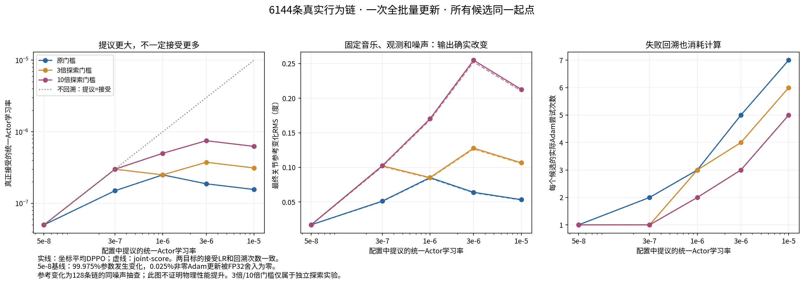
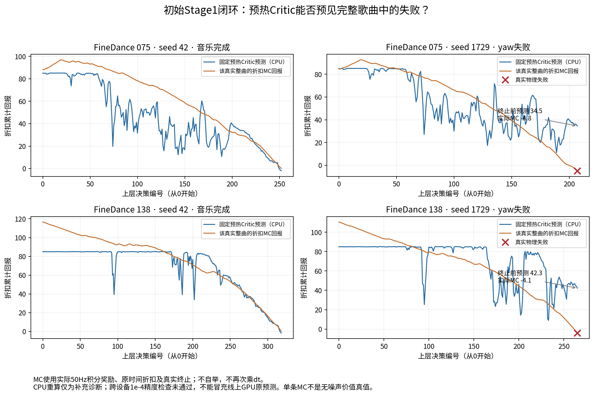
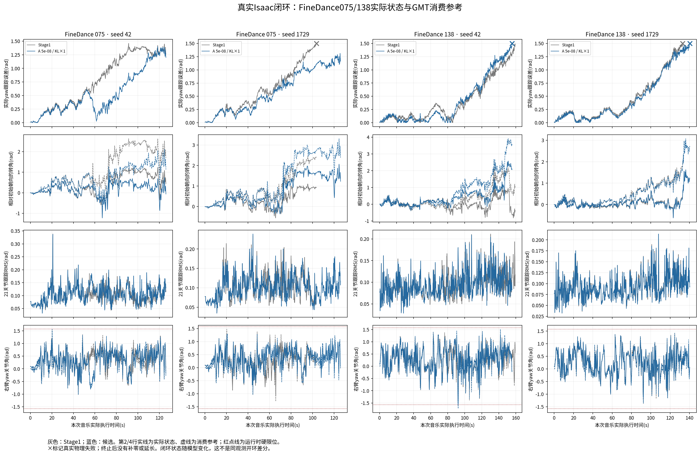
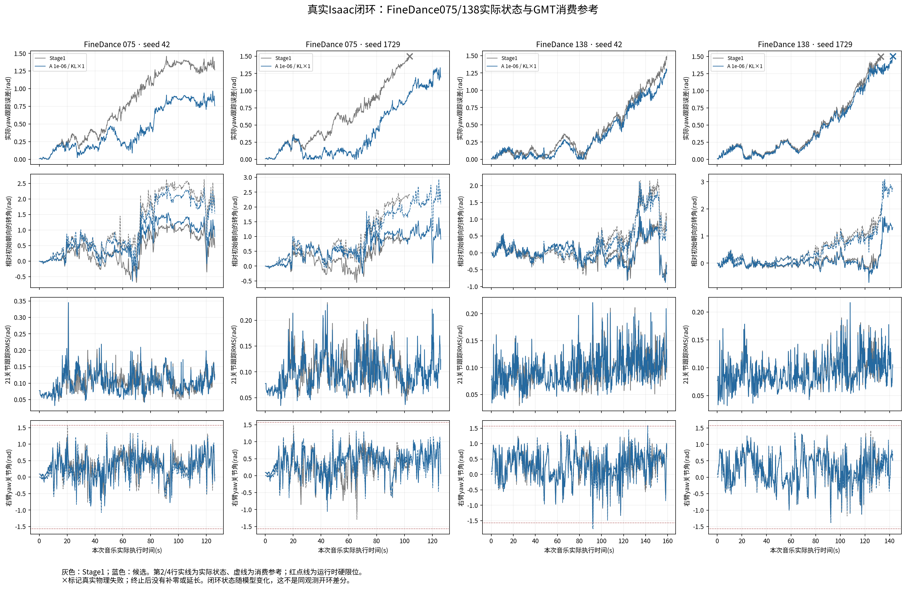

第二阶段统一 Actor 高学习率有限实验（服务器2）
================================================

报告状态
--------

固定真实数据扫描已完成。完整歌曲物理评估及后续八轮在线对照进行中，本文此时只对
已核验的数值结果下结论，不能作为长期正式训练许可。最终物理结果收齐后更新本节。
服务器1、既有Stage1/P1正式运行及其checkpoint均未修改，也未启动数百轮训练。

使用 GENMO ``feature/stage2-asymmetric-denoising`` 与 GMT
``feature/stage2-tracking-history``。GMT为 ``7c3353b``，本次未改变GMT源码。
实现的主要提交为 ``02f3df9``、``bcf3b8c``；评估、分析、有限编排为后续工具提交，
不在运行中修改 ``gem/`` 或训练入口的来源身份。用户确认使用临时本地检出，原本地
另一分支的未提交修改保留；全部有效修改只推送指定分支，交付后清理临时检出。

集中证据根目录（服务器2）：

::

  /data1/user/liwei/GENMO_outputs/closedloop_stage10/stage2_actor_lr_20261016

本轮解决的问题和改动
--------------------

本轮没有通过添加损失或改变噪声来掩盖小步长问题，而是分开测量三件事：FP32参数
实际更新了多少，同条件生成参考改变了多少，以及机器人完整音乐任务是否改善。

* ``full_batch_actor.py``：新增一次完整on-policy批量更新，所有可训练Actor参数只
  属于一个AdamW组。A保留自由有效坐标平均DPPO；B为独立joint-score单步目标，
  不对数千维联合log-ratio取指数，也不冒充joint PPO。
* ``actor_backtracking.py``：每次尝试从相同Actor、Adam、BC控制器和RNG起点恢复，
  固定梯度以1、1/2、1/4等LR倍率重试；最多9次。所有rank共同接受或拒绝，尝试
  预算不退款，完整失败恢复原状态。通过后仍做独立的本轮全部有效链四步KL审查。
* ``actor_step_diagnostics.py``：逐模块记录真实参数变化、FP32舍入、梯度、PPO/BC
  投影；固定128条真实链的音乐、观测、冻结前缀状态和创新噪声，重新生成最终
  qpos/contact，记录输出与优势的统计关系。这是输出诊断，不是物理质量证明。
* ``actor_experiment.py``、``training_config.py``、``kl_calibration.py``：实际LR、
  epoch、全局链批量、目标、BC、回溯和KL限制全部进入优化身份，旧5e-8证据不得
  为高LR或joint-score背书；实验最多16轮，当前配置只允许8轮。
* ``training.py``：接入单步更新、逐尝试资源账本、完整最终审查和每4轮物理/MC
  验证；保持采集后暂停PhysX，接受后才发布新策略版本，失败时恢复完整学习状态。
* ``gradient_merge.py``：只增加真实PPO/BC分量观察和显式首次梯度比例初始化。
  PPO、BC在本地累计，以真实全局分母加权，一次SUM后合成并裁剪，没有重复除卡数。

条件与可复核身份
----------------

保留s595000、冻结GMT140500、60帧/30Hz、0.5秒上层决策、50Hz控制/200Hz物理、
连续episode与4秒世界采集、八项GMT Tracking、参考/实际限位0.7/0.3、音乐和独立
Stability奖励关闭、非对称历史跟踪Critic。Actor不读取Critic特权历史。
完整20步结构仍为15步冻结随机先验、4步可训练随机转移、1步冻结确定性末步；
index15～18的实测std严格等于0.04/0.06/0.08/0.10，最后一步没有虚假Gaussian概率。

.. list-table:: 全部候选的共同参数
   :header-rows: 1

   * - 参数
     - 实际设置
   * - Actor统一LR
     - 5e-8 / 3e-7 / 1e-6 / 3e-6 / 1e-5
   * - AdamW
     - 一个参数组；FP32；betas=(0.9,0.999)，eps=1e-8，weight_decay=0
   * - PPO epoch / 全局链minibatch容量
     - 1 / 16384；按实际有效链数归一化，只提交一次更新
   * - 计算微批
     - Actor128、KL128，单位为去噪转移；CFG实际网络行另行展开
   * - BC
     - 每rollout全局1024样本，首次实测共享梯度范数比0.1，之后有界平滑
   * - BC系数范围
     - 1e-4～10000；上限适配joint-score量纲，不等于BC梯度占比
   * - 坐标DPPO clip
     - 0.003；joint-score不使用clip或joint ratio指数
   * - KL原门槛
     - 四步坐标均值0.0003、最大单步均值0.0006、四步P95 0.0007
   * - 探索门槛
     - 原值3倍 / 10倍，独立配置，未视作正式安全门禁
   * - Joint-chain KL附加门禁
     - 支持mean/P95/max可配置，本轮未任意指定未经配对验证的数值
   * - Critic
     - 历史GRU1e-5；时序融合/Value Head1e-4；每rollout32 epoch、全局batch2048

新采集 ``iteration000001`` 含6144条真实有效链，8卡各768条；首窗的初始化消耗使
其少于名义8192链，不强制补齐配额。每条链1262个自由有效坐标，前缀/padding不
计入概率目标。相同GAE、Stage1、空Actor Adam和BC样本用于全部30组候选。
每种目标仅计算一次固定梯度并在15个候选间复用，避免不同BC样本污染LR对照。
这里的5e-8对照同样使用新的一次全批量更新及首次BC实测比例设置，并非旧P1或
旧容量实验的多次minibatch更新；不能把跨实验的差异全部归因于学习率。

原始case SHA为
``ad016f3f7590464cbc93ab311214fae7345c411cc45316c2efed66e9cd8d188f``。
采样核SHA为
``9e2a93cf3626748eb6d8cc38d00a02600861148c4cc150bdaeae641a70bd7926``。
MC初始化SHA为
``e507e974719802afea3c563ee2a07da8912bd753cda98c6198e628b8d30e43a1``，
关键行为/价值依赖AST逐项未改变，实际严格加载通过，没有改写旧artifact的SHA。
该预热独立验证MSE130.315、EV0.84961；这是价值预测结果，不是Actor学习收益。

梯度和更新诊断
--------------

5e-8第一次真实Adam中，211496736个可训练参数的99.97463%发生变化，非零理论
Adam减量被FP32舍入成零的比例仅0.02537%。因此本批不支持“大多数参数被舍入
成零，等于没有学”的猜测。这个结论限定第一次空Adam起点，非空Adam后续步骤
由在线实验逐轮另外记录，不能直接外推。

A的PPO全局梯度范数0.254719，原始BC梯度3.353876，实际BC系数0.00759489，
加权BC/PPO范数比0.1，夹角余弦-0.020844；合成梯度范数0.255461，未触发范数
裁剪。B的原始PPO范数1314.629，BC系数39.19792，仍保持0.1目标比例；合成范数
1318.435，以0.000758475系数裁剪到1。不能将BC绝对系数39误读成39倍约束。

A/B真实PPO梯度余弦0.99992885，最佳标量缩放约5160.723倍，两者BC原始梯度
完全相同。在本批所有链自由坐标数相同、只在旧策略位置做一次更新的条件下，B
主要取消了A的坐标与四步平均；剩余方向差包括A的去噪折扣。Adam对共同尺度
基本不敏感，因此“联合score原始梯度大几千倍”没有带来几千倍参数或动作变化。
后续非空Adam、变长条件和在线优势分布下仍需实测，不能称两种算法普遍等价。

本批原始优势均值-0.02681、标准差4.52290，全局有效样本归一化后均值0、标准差1。
归一化优势标准差按来源为AIOZ0.6324、AIST0.3260、FineDance1.6454、Mine0.8633，
说明不同来源的梯度影响并不相同。A的两半rank梯度余弦0.05453，方向一致性仍弱。
该值是采样梯度诊断，不等价于价值预测EV，也不证明梯度指向更好的真实物理行为。

只读重建6144条真实转移的GAE，原始优势/回报最大误差为0；全局归一化最大误差
6.94e-18，未发现重复折扣、重复归一化或跨策略版本拼接。每上层转移的积分奖励
标准差0.4141，折扣价值差标准差2.9846；FineDance分别为0.2526与5.1116，其优势
与即时奖励相关性仅0.01161。优势主要受价值差影响，但价值差本来包含长期回报
信息，不能仅凭方差大判定Critic错误。完整当前行为MC另外诊断，不用GAE自举标签
反证同一Critic的正确性。

第一次梯度处在ratio=1，PPO clip没有限制这次起始梯度；soft KL也是更新前检查，
此时为0。实际接受幅度主要由更新后的hard KL及回溯控制。评估权重字段
``complete_update_and_soft_kl_passed``表达此更新前语义，不代表更新后KL低于soft阈值。

.. list-table:: 5e-8第一次Adam的关键模块实际变化
   :header-rows: 1

   * - 模块
     - 参数变化比例
     - FP32舍入零比例
     - 更新RMS
   * - Transformer骨干
     - 99.97485%
     - 0.02515%
     - 4.86756e-8
   * - qpos输出层
     - 99.99806%
     - 0.00194%
     - 4.96587e-8
   * - 音乐编码器
     - 99.98881%
     - 0.01119%
     - 4.95662e-8
   * - 历史编码器
     - 99.97610%
     - 0.02390%
     - 4.93132e-8
   * - 前缀编码器
     - 99.99929%
     - 0.00071%
     - 4.98910e-8
   * - Contact head
     - 99.76370%
     - 0.23630%
     - 3.81550e-8

可训练Actor的contact head主要接受BC梯度；实际最终contact来自独立冻结末步。
其变化不能当成最终接触输出变化，后者已用真实重新去噪结果单独测量。

固定条件下，5e-8最终关节参考RMS变化0.0002993rad（0.0171度）；提议1e-6、原门槛
接受2.5e-7时为0.0014902rad（0.0854度）。输出发生了更大变化，但该数字本身不能
说明机器人更稳。冻结参数身份、已承诺前缀及全部四步KL覆盖均保持。

计算成本的解释边界
------------------

30组候选共执行90次真实Adam尝试，全部记入资源账本；固定扫描不计为接受训练轮。
共享梯度计算A为30.013秒、B为28.378秒。候选回溯/审查阶段总计958.720秒，此数
不包含每种目标的共享梯度、加载、权重保存及真实物理采集，不能当作完整训练墙钟。

整次扫描nvidia-smi实测峰值26.765GiB（轮询测量）。候选字段
``peak_allocated_bytes_by_rank``在梯度计算后重置，只描述候选回溯/审查阶段的
PyTorch allocator峰值，不能冒充完整反向或含PhysX的训练峰值。在线对照单列
完整轮次PyTorch峰值和nvidia-smi整卡采样峰值，并保留监控采样间隔。

真实物理对照的判读规则
----------------------

每个不同Actor参数指纹执行相同16个独立音乐组×2 seed，共32任务。只有完整参数
指纹逐字节相同的候选共用一次物理结果，其余全部执行。30候选对应22组不同权重，
加本轮Stage1基线共23次串行评估；不同时启动多个Isaac作业争抢GPU。

运行到数据集最长可用配对音频/动作结束或真实物理失败，不使用4秒rollout长度
截断评估。可用配对样本长度为9.6～159.2秒；这不等于从短配对片段重建原始更长
音源全曲。报告保留每项实际可用长度，不把32任务称为32首独立音乐。

每项复核原始SHA、全部50Hz计奖控制和每控制4子步，分别比较总回报、每秒回报、
实际时长、完成率、新增/恢复失败、八项Tracking、活动度、yaw和三个域关节限位。
FineDance075/138另保存真实关节、消费参考、实际/参考姿态轨迹和完整生成窗口索引。
按16个音乐组聚类bootstrap，两个seed随同一音乐一起重采样；候选筛选存在多重
比较，单个95%区间不构成未经选择的独立显著性证明。

纯Actor evaluate-only入口没有导入MC预热Critic，其随机Value Head预测明确不用于
评判已验收Critic。在线第4/8轮分别固定当前Actor，用独立完整MC轨迹检查当前Critic，
不使用旧策略MC作为新行为无偏标签，不将GAE自举目标误报为MC。

另增加只读离线诊断：严格加载同一已验收Critic，对评估时保存的真实因果条件在
CPU重算，与各候选自身整曲MC回报比较。新Stage1基线3516个决策状态的MSE为
146.823、EV为0.834992、平均低估3.216。这些结果不更新Critic、不参与Actor训练。
128个真实采集状态的CPU/GPU预测最大差0.004799、RMS差0.001181，没有通过预设
1e-4一致性检查；关闭CPU MHA快路径、oneDNN或改成batch1未消除该差异。因此
离线数值只作为明确标注的CPU补充诊断，不能冒充线上原预测，也不能据此更改Actor
概率门槛。差异原始记录保留，当前无法据此认定是训练错误或声称跨设备严格等价。

上图把整体EV拆回具体音乐。FineDance的CPU MSE为236.85，另外三来源约10.60～
30.98；075/138的seed1729在最后一个真实失败前决策，预测分别34.53/42.26，
实际该条轨迹MC为-4.85/-4.13，最后20次决策平均高估27.84/38.37。075 seed42
成功轨迹又存在明显中段低估。这表明整体EV不能代表局部时序价值已可靠，尤其是
长曲晚段的失败预判。网络没有对价值做硬上限裁剪；图中接近84的平段是实际预测，
不能简单归因于人为截断。单条MC仍含随机性，CPU结果尚不替代GPU原预测验证，
更不能只凭这些残差证明某次PPO梯度必然方向错误。

后续在线选择规则在结果收齐前写入工具：完成数不得下降，总回报与实际时长
至少为Stage1的98%，活动度至少90%；实际/消费参考/完整生成的硬越界最大增量
分别不超过0.03/0.05/0.05rad，硬越界比例增量不超过0.002。这些只是有限仿真的
经验排除条件，不是正式安全保证。优先5e-8对照和A/B各自1e-6原KL候选，最多
补一组总回报增加至少1%、接受LR实际大于5e-8基线的放宽KL代表；若仍缺少另一
目标，再保留该目标通过相同条件的探索代表。总计最多4组、探索最多2组，每组
最多8轮，第4/8轮保存实际权重及评估。没有合格项的目标不能为了凑比较而放行。

上述目标覆盖补充为显式v2选择规则：在在线训练开始前、B组结果尚未收齐时更新，
旧v1仅保留一个探索组可能使A/B只剩一种目标。物理筛选数值门槛未变，旧等待器
仅在尚未创建在线run且无子进程时结束，原规则/命令/SHA保留在
``online_selection_coverage_amendment.json``；全30项物理结果仍完整保留。
启动前再明确v3低LR对照回退：若A的5e-8因物理退化被排除，用同门槛合格的B
5e-8作小步长对照；若两者都不合格，则不能强行加入。此项只补足同目标的LR
比较，不增加4组总上限，记录于 ``online_selection_control_amendment.json``。

上图只表示第一组5e-8单步对照。075的seed1729从原yaw失败变为完成，但138的
seed42新增yaw失败；不能把一个修复掩盖另一个退化。138 seed42约92秒的右臂yaw
消费参考硬越界从Stage1整体峰值0.05309rad增至0.15780rad，实际关节仍基本守住
硬限位。这一时段Stage1也在正常执行，不是新模型延长执行才暴露的额外区间。
完整曲线同时保留根朝向、真实yaw误差、关节跟踪与限位，不根据一列回报选优。

上图为A的1e-6原门槛组，实际接受2.5e-7。075 seed1729由失败恢复完成，075的
两条轨迹yaw跟踪均改善；138 seed1729仍失败。32任务整体完成30/32，总回报
增加2.344%，没有新增失败，但消费参考硬越界峰值增至0.19508rad，超过预先
登记的非退化筛选。因此它有局部物理收益，也有明确代价，不能只凭完成数晋升。

独立重复的Stage1基线与上一容量实验在相同任务/权重下，32任务摘要、八项
Tracking、奖励分项及限位统计完全一致；075/138四份真实轨迹的7个数组也逐项
相等。journal路径/SHA及墙钟延迟属于不同运行的来源信息，没有要求它们相同。
可复核记录为证据根的 ``stage1_reproducibility.json`` 和
``stage1_reproducibility_traces.json``；此处对照不是旧P1奖励或旧随机核。

本配置训练任务从歌曲开头开始、正常episode跨rollout持续。八轮4秒世界窗口最多
经历32秒世界时间，16轮也只有64秒；上图90～150秒的晚段故障不在短在线试验的
直接经验覆盖内。完整MC Critic见过长episode，不等于Actor已经在这些晚段状态
接受过PPO训练。这个覆盖边界限制短试验的解释，不能仅凭提高LR宣布解决长期故障。

验证记录与局限
--------------

新增事务/score/配置/小型真实扩散集成9项CPU通过；与Critic初始化、梯度/GAE和
KL身份选择回归共50项通过（包含重叠，不相加虚报独立用例）。物理队列、逐控制
分析和在线筛选的最新相关回归7项通过。八卡高斯数学检查最大误差3.602e-10；真实
6144条旧链零更新joint log-ratio最大绝对值0，全30候选rank参数诊断一致。

一次宽泛CPU测试选择出现Gloo等待，已仅结束该pytest进程，未把它报告为通过。
初次fixture导入及中文绘图字体问题修正后通过，原始失败说明保留。物理机器人
失败必须留在总量和任务对照中，不能当作基础设施异常删掉。

有限在线汇总工具额外核验第0/4/8轮实际checkpoint参数和buffer与物理评估指纹，
按真实有效链、1024个BC样本和全部回溯尝试重建优化成本，并复用逐控制物理分析。
该汇总工具3项CPU回归通过；真实八轮数据尚待候选筛选完成后产生。

原始完整模型、GPU日志、实际rollout与失败证据按本次用户交付要求保留在实验根；
本地/远程pytest临时夹具及不再使用的临时绘图缓存精确清理，代码和测试源文件保留。

全部30组固定数据实际结果
-----------------------

每项只提交1次Adam，表中“尝试”包含被回溯拒绝的计算。Joint列为四步链KL之和；
坐标P95为每链每步有效坐标平均KL的P95。RMS为128链同噪声最终关节参考变化。

.. csv-table:: A：坐标平均DPPO
   :header: "提议LR", "门槛倍数", "接受LR", "尝试", "平均KL", "最大步均值", "坐标P95", "Joint均值/P95/最大", "关节RMS(rad)", "FP32零更新(%)"
   :widths: 8, 6, 9, 4, 9, 9, 9, 18, 10, 10

   "5e-08", "1", "5e-08", "1", "1.04623e-05", "1.76833e-05", "2.31749e-05", "0.052814/0.097443/0.65947", "0.0002993", "0.02537"
   "5e-08", "3", "5e-08", "1", "1.04623e-05", "1.76833e-05", "2.31749e-05", "0.052814/0.097443/0.65947", "0.0002993", "0.02537"
   "5e-08", "10", "5e-08", "1", "1.04623e-05", "1.76833e-05", "2.31749e-05", "0.052814/0.097443/0.65947", "0.0002993", "0.02537"
   "3e-07", "1", "1.5e-07", "2", "9.37851e-05", "0.000158511", "0.000207683", "0.47343/0.87415/5.9099", "0.0008954", "0.00403"
   "3e-07", "3", "3e-07", "1", "0.000374913", "0.000633485", "0.000831107", "1.8926/3.4924/23.651", "0.0017881", "0.00204"
   "3e-07", "10", "3e-07", "1", "0.000374913", "0.000633485", "0.000831107", "1.8926/3.4924/23.651", "0.0017881", "0.00204"
   "1e-06", "1", "2.5e-07", "3", "0.00026025", "0.000439732", "0.000576737", "1.3137/2.4249/16.427", "0.0014902", "0.00243"
   "1e-06", "3", "2.5e-07", "3", "0.00026025", "0.000439732", "0.000576737", "1.3137/2.4249/16.427", "0.0014902", "0.00243"
   "1e-06", "10", "5e-07", "2", "0.00104043", "0.00175767", "0.00230639", "5.2521/9.6835/65.608", "0.0029740", "0.00122"
   "3e-06", "1", "1.875e-07", "5", "0.00014663", "0.000247806", "0.000324778", "0.74019/1.3663/9.2474", "0.0011193", "0.00323"
   "3e-06", "3", "3.75e-07", "4", "0.000585535", "0.000989318", "0.00129823", "2.9558/5.4522/36.934", "0.0022332", "0.00163"
   "3e-06", "10", "7.5e-07", "3", "0.00234048", "0.00395325", "0.00519056", "11.815/21.814/147.42", "0.0044516", "0.00082"
   "1e-05", "1", "1.563e-07", "7", "0.00010193", "0.000172245", "0.000225772", "0.51454/0.95019/6.4332", "0.0009333", "0.00387"
   "1e-05", "3", "3.125e-07", "6", "0.000407171", "0.000688014", "0.000902666", "2.0554/3.7924/25.681", "0.0018633", "0.00195"
   "1e-05", "10", "6.25e-07", "5", "0.00162587", "0.00274645", "0.00360323", "8.2074/15.145/102.46", "0.0037141", "0.00099"

.. csv-table:: B：joint-score单步策略梯度
   :header: "提议LR", "门槛倍数", "接受LR", "尝试", "平均KL", "最大步均值", "坐标P95", "Joint均值/P95/最大", "关节RMS(rad)", "FP32零更新(%)"
   :widths: 8, 6, 9, 4, 9, 9, 9, 18, 10, 10

   "5e-08", "1", "5e-08", "1", "1.03673e-05", "1.74822e-05", "2.29844e-05", "0.052334/0.096803/0.65933", "0.0002961", "0.01630"
   "5e-08", "3", "5e-08", "1", "1.03673e-05", "1.74822e-05", "2.29844e-05", "0.052334/0.096803/0.65933", "0.0002961", "0.01630"
   "5e-08", "10", "5e-08", "1", "1.03673e-05", "1.74822e-05", "2.29844e-05", "0.052334/0.096803/0.65933", "0.0002961", "0.01630"
   "3e-07", "1", "1.5e-07", "2", "9.30408e-05", "0.00015688", "0.00020609", "0.46967/0.8681/5.9176", "0.0008865", "0.00107"
   "3e-07", "3", "3e-07", "1", "0.000371569", "0.000626344", "0.000823402", "1.8757/3.4682/23.655", "0.0017692", "0.00054"
   "3e-07", "10", "3e-07", "1", "0.000371569", "0.000626344", "0.000823402", "1.8757/3.4682/23.655", "0.0017692", "0.00054"
   "1e-06", "1", "2.5e-07", "3", "0.000257728", "0.000434463", "0.000571252", "1.301/2.406/16.413", "0.0014740", "0.00064"
   "1e-06", "3", "2.5e-07", "3", "0.000257728", "0.000434463", "0.000571252", "1.301/2.406/16.413", "0.0014740", "0.00064"
   "1e-06", "10", "5e-07", "2", "0.00103077", "0.00173728", "0.00228325", "5.2033/9.6244/65.58", "0.0029422", "0.00032"
   "3e-06", "1", "1.875e-07", "5", "0.000145361", "0.000245073", "0.000322175", "0.73378/1.3564/9.253", "0.0011076", "0.00086"
   "3e-06", "3", "3.75e-07", "4", "0.000580217", "0.000978032", "0.00128585", "2.9289/5.4156/36.936", "0.0022096", "0.00043"
   "3e-06", "10", "7.5e-07", "3", "0.00231965", "0.0039089", "0.00514175", "11.71/21.686/147.41", "0.0044050", "0.00021"
   "1e-05", "1", "1.563e-07", "7", "0.000101034", "0.000170323", "0.000223859", "0.51002/0.9428/6.4346", "0.0009236", "0.00104"
   "1e-05", "3", "3.125e-07", "6", "0.000403631", "0.000680421", "0.00089435", "2.0375/3.7675/25.69", "0.0018438", "0.00051"
   "1e-05", "10", "6.25e-07", "5", "0.00161162", "0.00271606", "0.00356885", "8.1355/15.055/102.46", "0.0036755", "0.00026"

